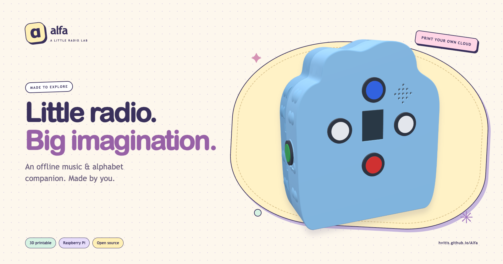
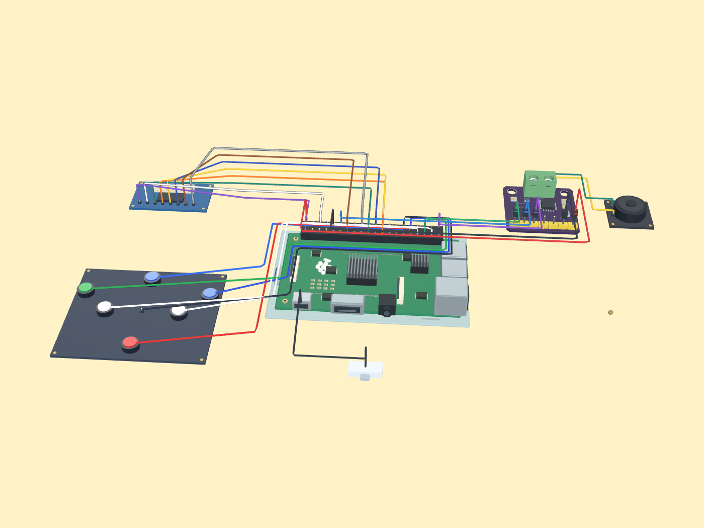
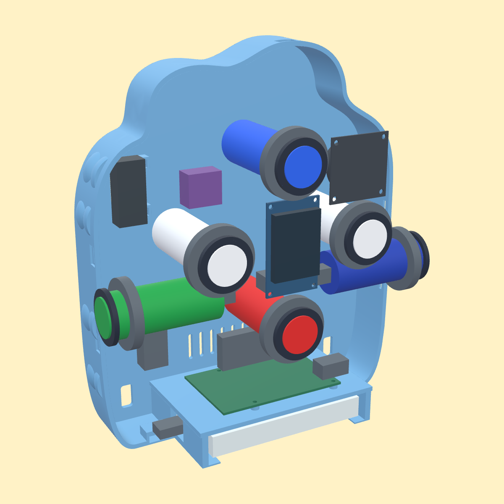
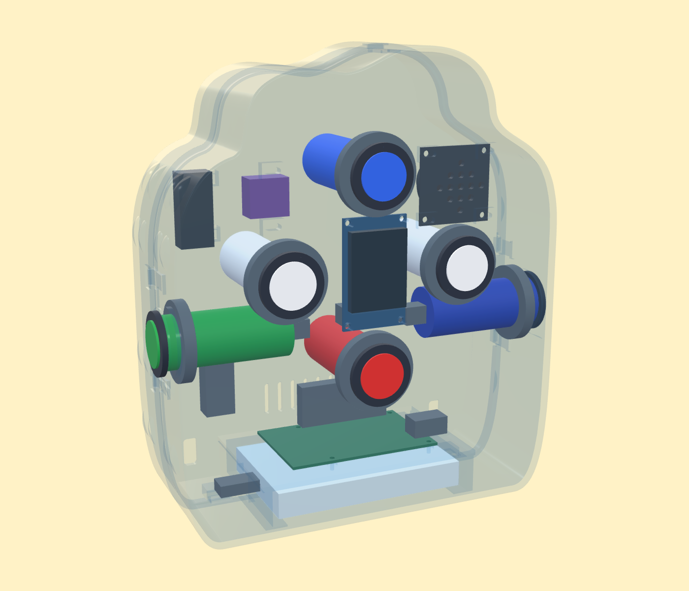
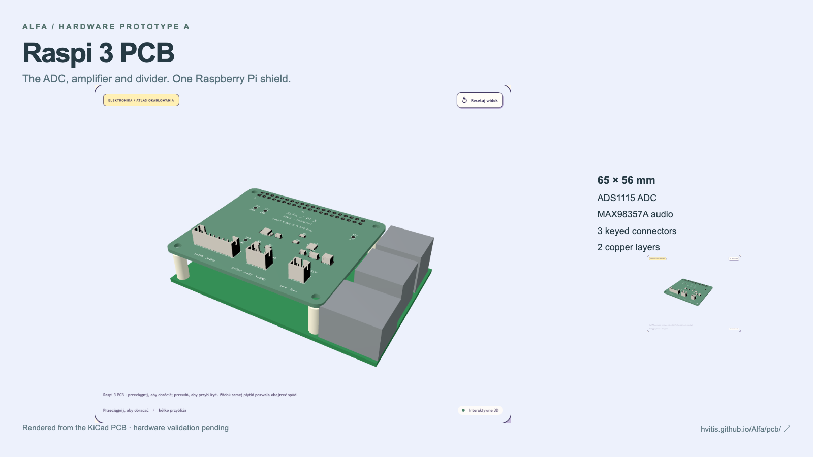
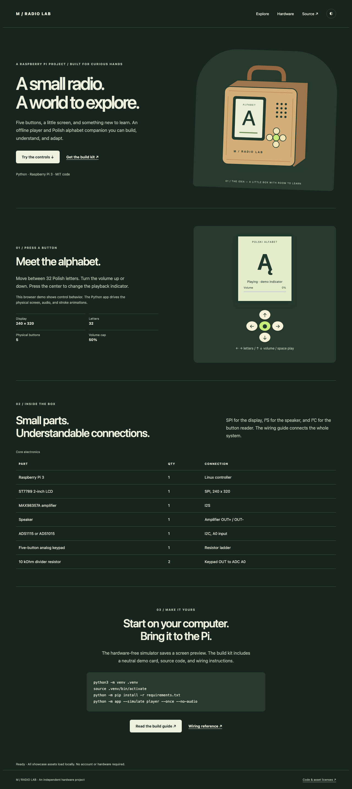
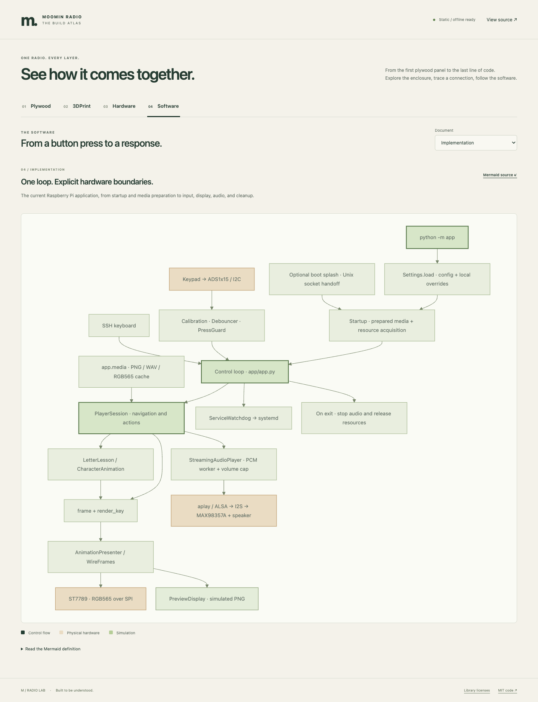

[English](README.en.md) · **Polski**

# α Alfa



[](https://github.com/hvitis/Alfa/actions/workflows/ci.yml)
[](LICENSE)

**Małe radio. Wielka wyobraźnia.**

Pastelowa chmurka, sześć przycisków arcade i 32 polskie litery do odkrycia. Alfa odtwarza muzykę i lekcje liter bez sieci.
Wydrukuj obudowę w swoich kolorach, zamontuj elektronikę i stwórz własne radio.

[Prezentacja w przeglądarce](https://hvitis.github.io/Alfa/) · [Najnowszy pakiet](https://github.com/hvitis/Alfa/releases/latest) · [Instrukcja sprzętu](docs/hardware-guide.md) · [Dokumentacja](docs/README.md)

## Zajrzyj do środka

| Połączenia układu | Wnętrze obudowy od tyłu | Widok rentgenowski elementów |
| --- | --- | --- |
|  |  |  |
| [Interaktywny schemat połączeń](https://hvitis.github.io/Alfa/#hardware) | [Wnętrze i montaż chmurki](design/cloud-radio/README.md) | [Pliki do druku chmurki](design/cloud-radio/README.md) |

**Odkryj warsztat:** [3DPrint](https://hvitis.github.io/Alfa/#3dprint) · [Sklejka](https://hvitis.github.io/Alfa/#plywood) · [Elektronika](https://hvitis.github.io/Alfa/#hardware) · [Oprogramowanie](https://hvitis.github.io/Alfa/#software)

[](https://hvitis.github.io/Alfa/pcb/)

**[Raspi 3 PCB — otwórz interaktywny model shielda](https://hvitis.github.io/Alfa/pcb/)** · [Projekt i instrukcja wykonania](design/pi3-shield/README.md).
Prototyp 65 × 56 mm mieści ADC, wzmacniacz i dzielnik bez osobnych modułów. Próby na sprzęcie pozostają do wykonania.

<details open>
<summary>Zobacz warsztat i schemat oprogramowania</summary>




</details>

Folder [CAD](design/) zawiera źródła obudów. Ilustrowany PDF dokumentu ADR jest w zakładce **Software → Design**.

## Specyfikacja

<!-- specifications:start -->
| Specification | Value |
| --- | --- |
| Code and documentation license | MIT |
| Runtime | Python 3.11+ |
| Validation toolchain | Python 3.12, Node.js 22, Chromium |
| Active controller | Raspberry Pi 3, Raspberry Pi OS Bookworm or newer |
| Display | ST7789, 240 × 320, SPI |
| Audio | MAX98357A, I²S, 48 kHz stereo PCM |
| Button input | Five-button keypad, ADS1115 or ADS1015, I²C |
| Divider | 2 × 10 kΩ |
| Backlight | BCM GPIO24 |
| Polish alphabet | 32 letters |
| Initial volume / cap | 20% / 50% |
| Static showcase | HTML, CSS, JavaScript; no backend |
<!-- specifications:end -->

Tabela używa tych samych nazw co wersja angielska, aby automatycznie wykrywać różnice między dokumentami.

## Funkcje

- <!-- feature:offline-player --> **Odtwarzacz bez sieci:** Pięć przycisków służy do zmiany obrazów, odtwarzania nagrań i regulacji głośności.
- <!-- feature:letter-lessons --> **Nauka liter:** Animacja rysuje 32 polskie litery, kreska po kresce. Istniejące grafiki postaci mają osobne informacje o prawach.
- <!-- feature:hardware-simulation --> **Symulacja sprzętu:** Komputer zapisuje podgląd ekranu bez urządzeń GPIO, SPI i I²C.
- <!-- feature:static-showcase --> **Prezentacja statyczna:** Zakładki Plywood, 3DPrint, Hardware i Software zawierają modele 3D, połączenia kontrolerów, ilustrowany PDF ADR i diagram Mermaid.
- <!-- feature:verified-distribution --> **Sprawdzany pakiet:** Pakiet zawiera neutralny obraz demonstracyjny, sumy kontrolne, raporty walidacji i zestawienie elektroniki.
- <!-- feature:enclosure-research --> **Projekty obudów:** Prezentacja obejmuje drukowaną chmurkę i oba projekty ze sklejki. Chmurka ma dwie skorupy łączone bez śrub, poziomą baterię na dole i Pi na półce nad nią. Ma 86 mm głębokości i 245 mm wysokości. Pliki zawierają STL, 3MF, STEP, próbki zatrzasków i instrukcję; zalecany stół to 256 × 256 mm.

## Szybki start

Użyj Pythona 3.11 lub nowszego. Zainstaluj FFmpeg do konwersji dźwięku.

```bash
python3 -m venv .venv
source .venv/bin/activate
python -m pip install -r requirements/base.txt
python -m app --simulate player --once --no-audio
```

Symulator zapisuje `.state/preview/current.png`. Repozytorium korzysta z istniejących przygotowanych multimediów.
Aplikacja, usługa Pi, ekran startowy i podgląd w przeglądarce używają jednego [config.json](config.json), z wyborem liter w `lesson.letters`.
Plik [installation.md](docs/installation.md) opisuje instalację lokalną i na Pi, a [configuration.md](docs/configuration.md) opisuje ustawienia.
Pakiet wydania zawiera neutralny obraz demonstracyjny.
Połączenia, kalibrację przycisków, sprawdzanie głośnika i instalację usługi opisuje [instrukcja sprzętu](docs/hardware-guide.md).

Po zamontowaniu lub obróceniu przycisków w obudowie uruchom na Pi `make mapping`.
Przypisz kolejno LEWO, PRAWO, GÓRĘ, DÓŁ i ŚRODEK zgodnie z instrukcjami. Polecenie przywraca wcześniej uruchomioną usługę.

Aby wyświetlić obraz na Pi 3 przed uruchomieniem Linuksa, użyj [instrukcji ekranu startowego firmware](docs/early-boot-splash.md).
Opisuje zgodny firmware, `make firmware-splash-install`, kopie zapasowe i usuwanie zmian.

Zainstaluj narzędzia programistyczne i uruchom lokalną prezentację:

```bash
make install
make check
make serve
```

Otwórz `http://127.0.0.1:8000`. Testy przeglądarki wymagają Node.js 22.
Plik [build-guide.md](docs/build-guide.md) opisuje wymagania Linuksa i środowisko.

## Automatyczna walidacja

`make check` sprawdza konfigurację, testy Pythona, składnię JavaScript, dane przeglądarki 3D i zgodność dokumentacji dwujęzycznej.
CI eksportuje prezentację i sprawdza ją w Chromium, w katalogu głównym oraz podkatalogu repozytorium, na ekranie komputera i telefonu.
Testy obejmują oba modele ze sklejki, drukowaną obudowę chmurki, połączenia obu kontrolerów, ADR, diagram Mermaid i lokalne zasoby.
`make build` uruchamia również symulator z pakietu i sprawdza zawartość archiwum oraz sumy SHA-256.

Połączenia fizyczne, głośność akustyczna, dopasowanie obudowy i prawa do multimediów wymagają osobnego przeglądu.
Automatyzacja oprogramowania nie potwierdza tych właściwości.

## Budowanie i publikacja

```bash
make smoke
make build
```

Pakiet powstaje jako `output/Alfa-Build-Kit.zip`. Raporty trafiają do `output/reports/`.
Pakiet zawiera aplikację Python, instrukcję połączeń, neutralny obraz i prezentację statyczną z siatkami modeli 3D.
Nie zawiera grafik postaci, nagrań ani starszej przeglądarki. Strona zawiera pliki chmurki do druku. Źródła strony i generator są w [web/](web/README.md).
Przeczytaj [zawartość wydania](docs/release-contents.md), [opis automatyzacji](docs/pipeline.md) i [kroki publikacji](docs/publishing.md).

CI sprawdza pull requesty. GitHub Pages wdraża stronę po poprawnych testach na `main`.
Wydanie wymaga tagu SemVer wskazującego rzeczywisty commit z gałęzi `main`.

## Współpraca i licencje

Plik [contributing.md](docs/contributing.md) opisuje pracę nad kodem.
Problemy bezpieczeństwa zgłaszaj zgodnie z [SECURITY.md](SECURITY.md).
[Licencja MIT](LICENSE) obejmuje oryginalny kod i dokumentację techniczną.
Plik [Informacje o zasobach i zależnościach](docs/third-party-notices.md) opisuje wyłączenia dotyczące zasobów i informacje o zależnościach.

Obudowa jest prototypem do sprawdzenia dopasowania. Próby fizyczne języków ustalających, zatrzasków, upadków i temperatury są nadal wymagane.
Grafiki postaci i nagrania wymagają osobnego przeglądu praw przed publikacją. Zobacz [listę czynności przed publikacją](docs/publishing.md).
Obrazy w README i karty społecznościowe są oryginalnymi renderami CAD.

Aby odtworzyć obrazy, uruchom `make serve`, a potem `npm run render:assets`. Polecenie `make site` eksportuje ilustrowany PDF ADR.
Karta GitHub: [.github/social-preview.png](.github/social-preview.png).
