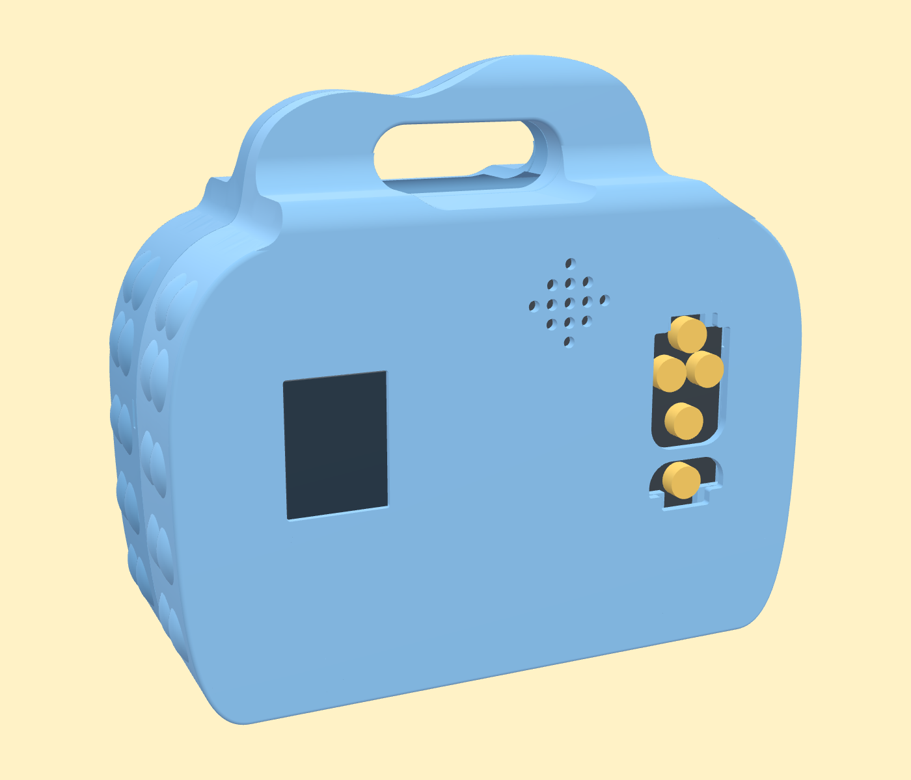
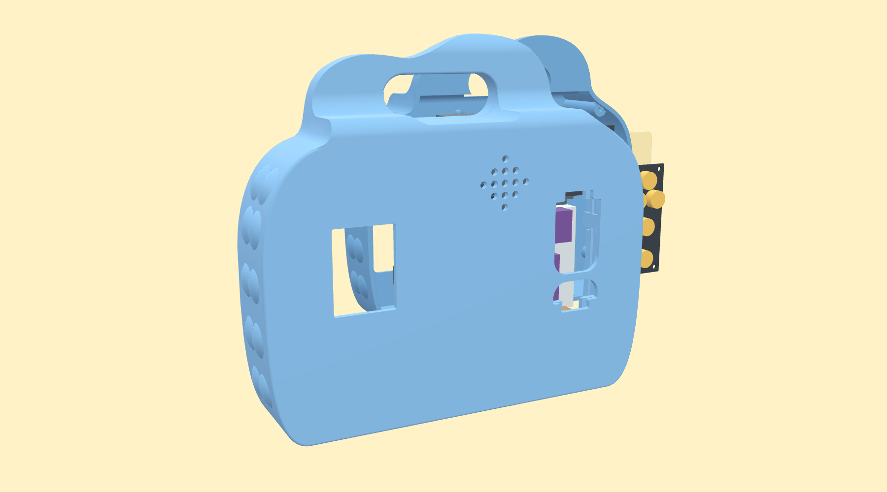
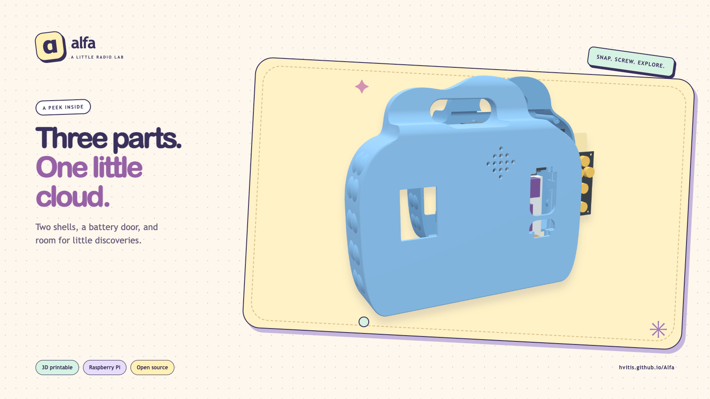

**English** · [Polski](README.pl.md)

# α Alfa


[](https://github.com/hvitis/Alfa/actions/workflows/ci.yml)
[](LICENSE)

**Little radio. Big imagination.**

A pastel cloud, five yellow buttons, and 32 Polish letters to explore. Alfa plays music and letter lessons offline on a Raspberry Pi.
Print the cloud in your favorite colors, fit the electronics, and make it your own.

[Live showcase](https://hvitis.github.io/Alfa/) · [Latest build kit](https://github.com/hvitis/Alfa/releases/latest) · [Hardware guide](docs/HARDWARE-GUIDE.md)

## A little look around

| Make a cloud | Peek inside |
| --- | --- |
|  |  |
| [Choose colors and download the print files](https://hvitis.github.io/Alfa/#3dprint) | [Assembly, dimensions and physical checks](design/cloud-radio/README.md) |



**Explore the build atlas:** [3DPrint](https://hvitis.github.io/Alfa/#3dprint) · [Plywood](https://hvitis.github.io/Alfa/#plywood) · [Hardware](https://hvitis.github.io/Alfa/#hardware) · [Software](https://hvitis.github.io/Alfa/#software)

<details>
<summary>See the interactive workshop and software map</summary>


</details>

The [CAD folders](design/) contain the enclosure sources. The website includes the illustrated ADR PDF under **Software → Design**.

## Specifications

<!-- specifications:start -->
| Specification | Value |
| --- | --- |
| Code and documentation license | MIT |
| Runtime | Python 3.11+ |
| Validation toolchain | Python 3.12, Node.js 22, Chromium |
| Active controller | Raspberry Pi 3, Raspberry Pi OS Bookworm or newer |
| Display | ST7789, 240 × 320, SPI |
| Audio | MAX98357A, I²S, 48 kHz stereo PCM |
| Button input | Five-button keypad, ADS1115 or ADS1015, I²C |
| Divider | 2 × 10 kΩ |
| Backlight | BCM GPIO24 |
| Polish alphabet | 32 letters |
| Initial volume / cap | 20% / 50% |
| Static showcase | HTML, CSS, JavaScript; no backend |
<!-- specifications:end -->

## Features

- <!-- feature:offline-player --> **Offline player:** Navigate images, play recordings, and adjust volume with five physical buttons.
- <!-- feature:letter-lessons --> **Letter lessons:** Draw 32 Polish letters stroke by stroke. The existing character assets have separate rights notes.
- <!-- feature:hardware-simulation --> **Hardware simulation:** Save display previews on your computer without GPIO, SPI, or I²C devices.
- <!-- feature:static-showcase --> **Static showcase:** Explore Plywood, 3DPrint, Hardware, and Software tabs, with 3D models, controller wiring, an ADR, and rendered Mermaid.
- <!-- feature:verified-distribution --> **Verified distribution:** Build a runtime kit with a neutral demo card, checksums, validation reports, and an electronics BOM.
- <!-- feature:enclosure-research --> **Enclosure research:** Inspect the printable cloud and both plywood projects. Cloud downloads include STL, STEP, snap coupons, and the assembly guide.

## Quick start

Use Python 3.11 or newer. Install FFmpeg for audio conversion.

```bash
python3 -m venv .venv
source .venv/bin/activate
python -m pip install -r requirements.txt
python -m app --simulate player --once --no-audio
```

The simulator saves `.state/preview/current.png`. The checkout uses existing prepared media.
The release kit supplies a neutral demo image instead.
For wiring, button calibration, speaker checks, and service installation, read the [hardware guide](docs/HARDWARE-GUIDE.md).

For the development tools and local showcase:

```bash
make install
make check
make serve
```

Open `http://127.0.0.1:8000`. Use Node.js 22 for the browser checks.
Read [BUILD-GUIDE.md](docs/BUILD-GUIDE.md) for Linux prerequisites and environment details.

## Automated validation

`make check` runs configuration checks, Python tests, JavaScript syntax checks, viewer data tests, and bilingual documentation checks.
CI exports the static showcase and runs Chromium checks at the domain root and a repository subpath, on desktop and mobile.
Browser checks cover both plywood models, the printable cloud, both wiring atlases, the illustrated ADR PDF, rendered Mermaid, social images, and local assets.
`make build` also runs the packaged simulator and verifies archive contents and SHA-256 checksums.

The cloud is a fit prototype. Its digital geometry checks do not replace physical print, grip, snap, drop, and temperature tests.
Physical wiring, acoustic volume, enclosure fit, and media redistribution rights require separate review.
The software pipeline does not certify those properties.

## Build and publish

```bash
make smoke
make build
```

The kit is `output/Alfa-Build-Kit.zip`. Reports are in `output/reports/`.
The kit includes the Python runtime, wiring guide, neutral demo image, and static atlas with its viewer meshes.
It excludes character media, recordings, and the legacy viewer. The static site includes the cloud print downloads. Website sources and generation live in [web/](web/README.md).
Read [release contents](docs/RELEASE-CONTENTS.md), [pipeline details](docs/PIPELINE.md), and [publication steps](docs/PUBLISHING.md).

CI validates pull requests. GitHub Pages deploys after successful checks on `main`.
Releases require a SemVer tag whose actual commit is on `main`.

## Contributing and licenses

Read [CONTRIBUTING.md](docs/CONTRIBUTING.md) for the development workflow.
Use [SECURITY.md](SECURITY.md) for security reports.
The [MIT license](LICENSE) covers original code and technical documentation.
[THIRD_PARTY_NOTICES.md](THIRD_PARTY_NOTICES.md) records asset exclusions and dependency notices.
Existing character artwork and recordings require a separate rights review before public visibility.
Read the [publication checklist](docs/PUBLISHING.md). The README and social cards use original CAD renders.

To recreate these images, run `make serve`, then `npm run render:assets`. Run `make site` to export the illustrated ADR PDF.
The GitHub social card is [.github/social-preview.png](.github/social-preview.png).
