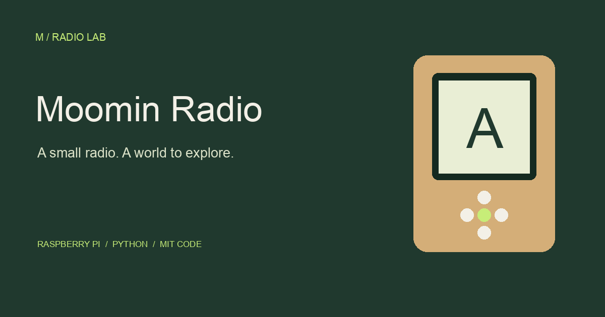

**English** · [Polski](README.pl.md)

# Moomin Radio



[](https://github.com/hvitis/moomin/actions/workflows/ci.yml)
[](LICENSE)

An offline Raspberry Pi player with a small screen, five buttons, and Polish letter lessons.

[Live showcase](https://hvitis.github.io/moomin/) · [Latest build kit](https://github.com/hvitis/moomin/releases/latest) · [Hardware guide](docs/HARDWARE-GUIDE.md)

The showcase and release links become available after the first successful deployment and tagged release.
The original code and technical documentation use MIT. Existing character artwork and recordings require a separate rights review before public visibility.
See [asset notices](THIRD_PARTY_NOTICES.md) and the [publication checklist](docs/PUBLISHING.md).

## Gallery

| Device concept | Interactive showcase |
| --- | --- |
|  |  |

The illustration is a concept. The [CAD folders](design/) contain separate enclosure designs and their build instructions.

## Specifications

<!-- specifications:start -->
| Specification | Value |
| --- | --- |
| Code and documentation license | MIT |
| Runtime | Python 3.11+ |
| Validation toolchain | Python 3.12, Node.js 22, Chromium |
| Active controller | Raspberry Pi 3, Raspberry Pi OS Bookworm or newer |
| Display | ST7789, 240 × 320, SPI |
| Audio | MAX98357A, I²S, 48 kHz stereo PCM |
| Button input | Five-button keypad, ADS1115 or ADS1015, I²C |
| Divider | 2 × 10 kΩ |
| Backlight | BCM GPIO24 |
| Polish alphabet | 32 letters |
| Initial volume / cap | 20% / 50% |
| Static showcase | HTML, CSS, JavaScript; no backend |
<!-- specifications:end -->

## Features

- <!-- feature:offline-player --> **Offline player:** Navigate images, play recordings, and adjust volume with five physical buttons.
- <!-- feature:letter-lessons --> **Letter lessons:** Draw 32 Polish letters stroke by stroke. The existing character assets have separate rights notes.
- <!-- feature:hardware-simulation --> **Hardware simulation:** Save display previews on your computer without GPIO, SPI, or I²C devices.
- <!-- feature:static-showcase --> **Static showcase:** Try the controls in a browser. All runtime assets load from the exported directory.
- <!-- feature:verified-distribution --> **Verified distribution:** Build a runtime kit with a neutral demo card, checksums, validation reports, and an electronics BOM.
- <!-- feature:enclosure-research --> **Enclosure research:** Explore the existing 3D wiring viewer and CAD designs through their separate build instructions.

## Quick start

Use Python 3.11 or newer. Install FFmpeg for audio conversion.

```bash
python3 -m venv .venv
source .venv/bin/activate
python -m pip install -r requirements.txt
python -m app --simulate player --once --no-audio
```

The simulator saves `.state/preview/current.png`. The checkout uses existing prepared media.
The release kit supplies a neutral demo image instead.
For wiring, button calibration, speaker checks, and service installation, read the [hardware guide](docs/HARDWARE-GUIDE.md).

For the development tools and local showcase:

```bash
make install
make check
make serve
```

Open `http://127.0.0.1:8000`. Use Node.js 22 for the browser checks.
Read [BUILD-GUIDE.md](docs/BUILD-GUIDE.md) for Linux prerequisites and environment details.

## Automated validation

`make check` runs configuration checks, Python tests, JavaScript syntax checks, viewer data tests, and bilingual documentation checks.
CI exports the static showcase and runs Chromium checks at the domain root and a repository subpath, on desktop and mobile.
Browser checks cover letter navigation, volume limits, playback indicators, theme changes, images, and local asset loading.
`make build` also runs the packaged simulator and verifies archive contents and SHA-256 checksums.

Physical wiring, acoustic volume, enclosure fit, and media redistribution rights require separate review.
The software pipeline does not certify those properties.

## Build and publish

```bash
make smoke
make build
```

The kit is `output/Moomin-Radio-Build-Kit.zip`. Reports are in `output/reports/`.
The kit includes the Python runtime, wiring guide, neutral demo image, and offline showcase.
It excludes existing character media, recordings, the research viewer, and generated CAD deliverables.
Read [release contents](docs/RELEASE-CONTENTS.md), [pipeline details](docs/PIPELINE.md), and [publication steps](docs/PUBLISHING.md).

CI validates pull requests. GitHub Pages deploys after successful checks on `main`.
Releases require a SemVer tag whose actual commit is on `main`.

## Contributing and licenses

Read [CONTRIBUTING.md](docs/CONTRIBUTING.md) for the development workflow.
Use [SECURITY.md](SECURITY.md) for security reports.
The [MIT license](LICENSE) covers original code and technical documentation.
[THIRD_PARTY_NOTICES.md](THIRD_PARTY_NOTICES.md) records asset exclusions and dependency notices.
