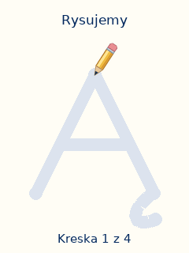

# Letter drawing lessons

Tap CENTER (the fifth button) to replay the selected letter recording.
Hold CENTER for 0.6 seconds to start or resume drawing. Release CENTER to pause.
A short press cancels a paused trace and replays the letter.
On an SSH keyboard, Space or Enter replays the recording. Each F supplies a 0.2-second hold pulse for drawing.
The single `config.json` enables this feature for manual and service use.

The lesson shows a pale guide and a tilted yellow pencil with a graphite tip and pink eraser.
The pencil follows the stroke endpoint and moves smoothly between strokes without adding connecting lines.
The strokes are 16 pixels thick on the 240 × 320 display, compared with the previous 10 pixels.
Each letter uses the navy color sampled from its still-image card.
It draws each stroke in order, with a short pause between strokes.
It draws Polish accents and ogoneks after the main letter.
The finished letter stays visible during the success fireworks.
The original character card returns when the fireworks finish.



[View all 32 completed letters](../../docs/letter-drawing-contact-sheet.png).

## Controls and timing

| Button | Action |
|---|---|
| LEFT / RIGHT | Interrupt the lesson, select the previous or next letter, and play its recording |
| UP | Slide the speaking character in from above, then animate and ask “Powiedz jaka to literka.” |
| DOWN | Randomly choose the clapping character or Hemulen, slide in from below, then play its paired praise |
| Tap CENTER | Replay the selected letter recording |
| Hold CENTER for 0.6 seconds | Start or resume the selected letter lesson |

CENTER never exits the alphabet. Press Q or Ctrl+C to exit a manual run.
The standalone service ignores Q.

The default lesson needs about 6 seconds of total hold time, depending on its stroke count.
It has a 0.5-second introduction, 5 seconds of tracing, and 0.22-second pauses between strokes.
The completed letter stays visible for 0.7 seconds before the 1.8-second fireworks animation.
After the last stroke, these timers run independently of CENTER. Releasing the button cannot pause the fireworks.
If the recording lasts longer, the completed letter stays visible until that recording ends.
After 20 seconds idle, a character peeks in. After five minutes, the backlight and amplifier sleep.
Any button wakes the device without rebooting.

The `letter_drawing` section in [config.json](../../config.json) sets these durations and a target of 20 frames per second.
The display worker skips obsolete frames and transfers only changed rectangles during the lesson.
The actual frame rate depends on the Pi and the display connection.

## Components and data

| Component | Responsibility |
|---|---|
| [letters.json](letters.json) | All 32 Polish uppercase letters, stroke order, shared marks, card colors, and recording paths |
| [LetterCatalog and Stroke](../../app/letter_paths.py) | Resolve a card filename, expand shared geometry, and measure stroke paths |
| [LetterLesson](../../app/letter_lesson.py) | Control introduction, tracing, pen lifts, the completed letter, and fireworks |
| `LetterRenderer` and `Pencil` in that module | Draw the guide, completed strokes, pencil, and fireworks |
| [LetterRecordings](../../app/audio.py) | Play prepared letter recordings, the question, and the chosen character's praise clip |
| [PlayerSession](../../app/player.py) | Connect button actions to lessons, audio, navigation, and card movement |
| [AnimationPresenter](../../app/frames.py) | Retain one frame and transfer only changed pixels |
| [ST7789.show_region](../../app/hardware.py) | Send a rectangle through SPI with the configured display rotation |

The complete stroke catalog is less than 8 KB.
The app retains flattened geometry only for the active letter.
It generates frames as playback advances.
Playback needs no videos, generated frame files, FFmpeg conversion, or additional Python packages.
The GIF and contact sheet are review artifacts. The app does not load them.

Coordinates use a 100 × 100 canvas.
Each stroke starts with `M` and continues with `L`, `Q`, or `C` commands.
These commands mean move, line, quadratic curve, and cubic curve.
Each stroke is one pen movement without a lift.
The renderer advances by path distance for a consistent speed through curves.
Letters such as Ą and Ę reuse the base letter and the shared ogonek.
The generator samples the dominant navy from each prepared card and stores it as the letter's `ink` color.
Playback reads this color from the catalog. It does not sample card pixels during each lesson.
The pencil uses two small sprites generated once, with a separate orientation for accents near the top.

These are simple printed uppercase forms with one consistent teaching sequence.
They do not trace the character artwork or teach cursive handwriting.

To change a letter, edit [generate-letter-data.py](../../scripts/generate-letter-data.py).
Then regenerate the catalog and previews:

```bash
python3 scripts/generate-letter-data.py
python3 scripts/preview-letter-drawing.py
```

To preview another letter, run:

```bash
python3 scripts/preview-letter-drawing.py --letter Ż --destination output/letter-Ż.gif
```

## Add recordings

Each letter has its own recording path in `letters.json`.
All 32 recording slots now contain audio. Missing selected recordings produce a startup error.
The app plays the selected recording on navigation, a short CENTER press, or the start of a new drawing lesson.
Navigation or UP/DOWN stops the lesson.
UP/DOWN first slides a still animation frame onto the screen. Animation and speech start after the slide finishes.
`--no-audio` also keeps all drawing lessons silent.

Read [the recording guide](../../media/letter-sounds/README.md) for offline Piper generation and individual replacements.
Put prepared WAV recordings in `media/letter-sounds/`.
Use stereo, 48 kHz, 16-bit PCM WAV files.
For example, convert an original recording with:

```bash
ffmpeg -i sounds/letter-A-original.wav -ar 48000 -ac 2 -c:a pcm_s16le media/letter-sounds/00-A.wav
```

The original recording remains separate from its prepared WAV file.
The player uses the configured digital volume, which defaults to 20%.
The existing speaker-test command remains available for speaker diagnostics.

## Run on the Pi

From the Pi project directory, run:

```bash
make update
```

For a manual hardware test, use `make run`.
This command stops the service to release its GPIO pins, then restores the service after the test ends.

After fitting or rotating the controls in the case, run:

```bash
make mapping
```

Face the front of the case. Hold the button for each requested action, then press Enter in the terminal.
The mapping supports horizontal, vertical, and reversed boards because it uses measured voltages for the chosen actions.
The command saves `.state/buttons.json` and restores a previously running service.

For a silent preview without hardware, run:

```bash
python3 -m app --simulate gallery --fullscreen --keyboard --no-audio
```

Simulation updates `.state/preview/current.png` as the lesson plays.

The automated tests cover all letter mappings, stroke interpolation, marks, recordings, controls, fireworks, card restoration, and rotated rectangle transfers.
The full keyboard loop also covers compiled card transfers before and after a lesson.
Physical display speed and speaker output still need a check on the Pi.

## If CENTER does nothing

Read the active service configuration and recent logs on the Pi:

```bash
systemctl show alfa.service -p WorkingDirectory -p ExecStart
journalctl -u alfa.service -n 30 --no-pager
```

The startup log reports `Letter drawing enabled` and the stroke catalog path.
If drawing is disabled, the log reports the configuration setting to enable.
The service and manual commands use `config.json` from the updated project folder.

After a CENTER action, the log reports the action and selected card filename.
For example, `CENTER: Drawing A; card=000-00-A.png` confirms that the app started the lesson.
`No drawing for this card` means the card filename does not match a letter in the catalog.

If there is no CENTER log, stop the service and inspect physical button events:

```bash
sudo systemctl stop alfa.service
.venv/bin/python -m app buttons
```

Press and release the fifth button. Its press event must identify `center`.
Press Ctrl+C to stop the monitor, then restart the service:

```bash
sudo systemctl start alfa.service
```
