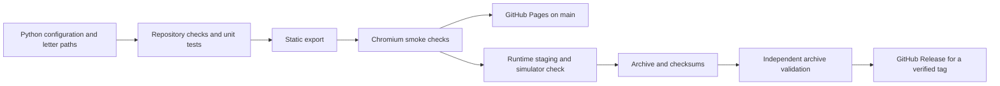

# Pipeline

## Data flow

## Pull requests and main

`.github/workflows/ci.yml` runs with read access to repository contents.
It installs only hardware-free Python dependencies and Playwright. Pi GPIO libraries and CAD tools are absent.
Python and npm dependency downloads use the setup actions' caches.
The small manifest always regenerates from source. No generated geometry cache can become stale.

The browser checks serve `_site/` at `/` and `/repo-preview/`, at desktop and mobile widths.
They reject runtime requests to other origins, failed requests, HTTP errors, and browser exceptions.
They exercise letter wraparound, both volume bounds, keyboard navigation, playback indicators, theme changes, and image loading.

Only successful `main` runs upload a Pages artifact. Pull requests cannot deploy.
The separate deployment job receives `pages: write` and `id-token: write`.
The `github-pages` environment controls deployment access.

## Tagged releases

The release workflow accepts `v*` pushes or an explicitly selected existing tag.
The gate parses full SemVer, resolves the actual tag commit, checks the checkout, and checks ancestry against `origin/main`.
A commit already on `main`, including its current tip, passes. A commit unique to another branch fails.
The same check applies to annotated tags and lightweight tags.

The build job checks out the verified commit and runs the complete software pipeline.
It receives read access. Its logs remain available as a diagnostic artifact after failure.
Only the final publish job receives `contents: write`. It runs no repository code.
That job downloads the exact deliverables and verifies the archive with `SHA256SUMS` before publication.
Manual tag inputs enter shell commands through environment variables and quoted arguments.

## Reports

| Report | Fields and meaning |
| --- | --- |
| `output/reports/build-manifest.json` | Schema version, commit, timestamp, dirty state, tool versions, artifact size and SHA-256. |
| `output/reports/validation.json` | Timestamp, commit, aggregate status, named checks and Boolean results. |
| `output/reports/hardware.csv` | Core electronics, quantities, and interfaces. No estimated costs or enclosure measurements. |
| `output/SHA256SUMS` | SHA-256 for the release ZIP. |
| ZIP `checksums.json` | SHA-256 for every other archive entry. |

The build replaces any previous validation status with `FAIL` before it starts.
Each completed subprocess adds a check result. A nonzero exit stops packaging or publication.
Archive validation checks required files, duplicate names, unsafe paths, excluded content, checksums, and report presence.

## Limits

The current-tree credential scan detects private-key headers and common GitHub and AWS token formats.
It does not scan all Git history or prove that no secrets exist.
Asset ownership requires human evidence, as described in [PUBLISHING.md](PUBLISHING.md).
The release validates software. Acoustic output, wiring, and fabrication geometry require their own checks.
