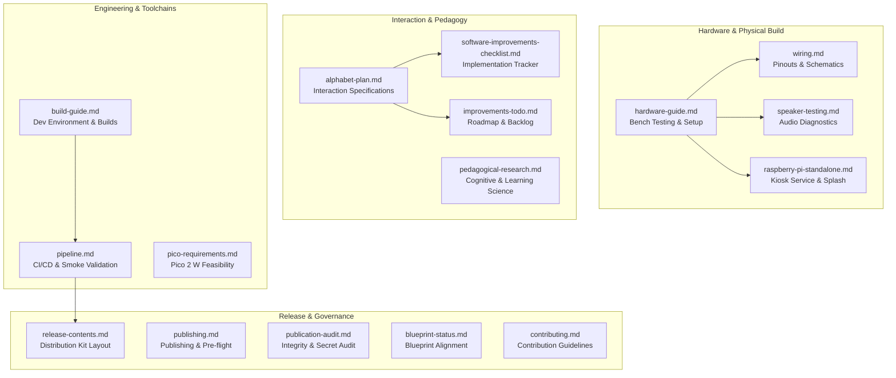

# Alfa Documentation

Welcome to the technical documentation for **Alfa**, an offline Raspberry Pi audio player and interactive Polish alphabet companion for young children.

This directory contains the engineering specifications, wiring schematics, deployment guides, interaction plans, and architectural research supporting the physical device and open-source project.

Start with [installation.md](installation.md) for local and Pi setup, then [configuration.md](configuration.md) for the single application configuration.
Read [early-boot-splash.md](early-boot-splash.md) to install the firmware LCD splash and measure its power-on timing.
The [project blueprint](project-blueprint.md), [contribution guide](contributing.md), and [asset notices](third-party-notices.md) also live here.

---

## Documentation Map

---

## Document Index

### 1. Hardware, Wiring & Kiosk Deployment

| Document | Focus Area | Description |
|---|---|---|
| [**hardware-guide.md**](hardware-guide.md) | Workbench Testing | Step-by-step instructions to configure Raspberry Pi OS, test the LCD, calibrate ADC buttons, and run diagnostics. |
| [**wiring.md**](wiring.md) | Electrical Reference | Full pinout tables, resistor divider schematics, and connection references for ST7789 LCD, MAX98357A, and ADS1115. |
| [**speaker-testing.md**](speaker-testing.md) | Audio Verification | Dedicated guide for testing the I²S DAC and passive speaker with live LCD status reporting and signal analytics. |
| [**raspberry-pi-standalone.md**](raspberry-pi-standalone.md) | Systemd Kiosk | Offline autostart configuration, instant early-boot splash screen, systemd watchdog monitoring, and SD card durability. |

### 2. Interaction, Pedagogy & Design

| Document | Focus Area | Description |
|---|---|---|
| [**alphabet-plan.md**](alphabet-plan.md) | Interaction Spec | Fixed-function keypad mapping, continuous ALSA audio mixing, hold-to-draw tracing physics, and sleep timers. |
| [**pedagogical-research.md**](pedagogical-research.md) | Learning Science | Research analysis (Piaget, Montessori, Vygotsky, Dehaene, Ehri), comparative audit of Alfa's method, and improvement roadmap. |
| [**software-improvements-checklist.md**](software-improvements-checklist.md) | Feature Tracking | Verification status for the five core interaction improvements and remaining physical hardware checks. |
| [**improvements-todo.md**](improvements-todo.md) | Roadmap & RFCs | Backlog covering early childhood phonics methodology, audio indexing pipelines, NFC token games, and hardware upgrades. |

### 3. Engineering, Builds & Platform Research

| Document | Focus Area | Description |
|---|---|---|
| [**build-guide.md**](build-guide.md) | Development Setup | Toolchain prerequisites (Python 3.12, Node.js 22, FFmpeg), local test commands, showcase builds, and clean targets. |
| [**pipeline.md**](pipeline.md) | Automation & CI/CD | Workflow details for automated validation, Playwright Chromium smoke testing, Pages deployment, and tag verification. |
| [**pico-requirements.md**](pico-requirements.md) | Embedded Feasibility | Flash and SRAM memory budgets, streaming display mechanics, and I²S audio architecture for the Raspberry Pi Pico 2 W. |

### 4. Release, Publishing & Governance

| Document | Focus Area | Description |
|---|---|---|
| [**release-contents.md**](release-contents.md) | Distribution Layout | File structure and manifest description of the standalone runtime kit (`Alfa-Build-Kit.zip`). |
| [**publishing.md**](publishing.md) | Release Procedure | Checklist and commands for branch protection, Gitleaks secret verification, public repository export, and tag publishing. |
| [**publication-audit.md**](publication-audit.md) | Compliance Audit | Historical audit report confirming secret scanning, SHA-256 asset checksums, licensing terms, and test coverage. |
| [**blueprint-status.md**](blueprint-status.md) | Project Alignment | Status mapping between the architectural blueprint and actual implementation. |
| [**contributing.md**](contributing.md) | Contributor Guide | Development practices, code formatting, test requirements, and pull request checklist. |

---

## Related Project Resources

- **Physical Enclosure Designs:**
  - [Cloud Radio (3D Printable)](../design/cloud-radio/README.md) — Parametric printable shells, snap joints, and assembly diagrams.
  - [Wooden Case (Laser-cut Plywood)](../design/wooden-case/README.md) — 6 mm plywood templates, placement plans, and cutting guides.
  - [House Radio](../design/house-radio/README.md) — Architectural cottage-style enclosure concept and booklet.
- **Web Showcase & 3D Visualizer:**
  - [Interactive Showcase](../web/README.md) — Static 4-tab Three.js viewer, controller explorer, and illustrated Architecture Decision Record (ADR).
- **Media & Asset Catalogs:**
  - [Alphabet Cards](../assets/alphabet/README.md) — 32 illustrated Polish letter cards.
  - [Letter Drawing Assets](../assets/letter-drawing/README.md) — Vector stroke paths and font coordinates for dynamic tracing.
  - [Letter Audio Recordings](../media/letter-sounds/README.md) — Phonetic audio clips, spoken prompts, and speaker configurations.
