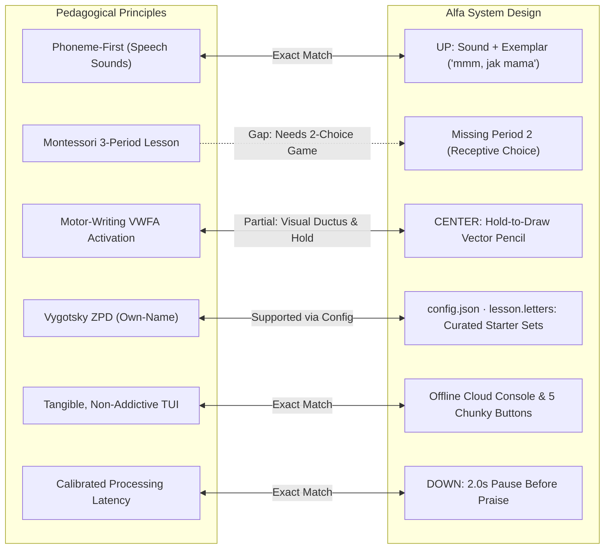

# Early Letter Acquisition & Pedagogical Research

This document synthesizes findings from developmental psychology, cognitive neuroscience, and early childhood pedagogy (**Jean Piaget, Maria Montessori, Lev Vygotsky, Stanislas Dehaene, and Linnea Ehri**) on how young children (ages 2–6) acquire letter knowledge as early and effectively as possible. It evaluates Alfa’s physical, multisensory design against these findings and outlines actionable pedagogical improvements.

---

## 1. How Children Learn Letters: Scientific Foundations

### A. Jean Piaget: Preoperational Thought & Sensorimotor Grounding
* **Developmental Stage (Ages 2–7):** Toddlers and preschoolers reside in Piaget's **Preoperational Stage**. They do not yet possess the cognitive architecture for formal operational logic or purely abstract symbol manipulation.
* **Concrete Before Abstract:** Letters are arbitrary symbols. A young child cannot internalize a grapheme through passive visual exposure alone; meaning is constructed through **physical sensorimotor action** (touching, pressing, moving, pointing).
* **Centration & Perceptual Salience:** Preoperational children center their attention on one salient feature at a time (e.g., color, curves, orientation).
* **Self-Relevance (Egocentrism):** New concepts stick when anchored to the child's direct emotional world—most notably their own name (*"the Own-Name Effect"*), parents' names, and familiar everyday objects.

### B. Maria Montessori: Sensitive Periods & The 3-Period Lesson
* **The Sensitive Period for Language (Ages 2.5–5):** Montessori identified an innate developmental window where children effortlessly absorb phonemes, shapes, and symbols if provided with structured sensorial materials.
* **The Three-Period Lesson (*Lekcja trójstopniowa*):**
  1. **Period 1: Naming / Introduction** (*"This is [M]"*) — Direct sensory association (seeing and hearing the sound).
  2. **Period 2: Recognition / Association** (*"Where is [M]?"*) — Receptive identification. The child points to or picks the correct symbol from a small set. **80% of learning occurs during this active discrimination stage.**
  3. **Period 3: Recall / Production** (*"What is this?"*) — Expressive recall (vocalizing the sound or drawing the shape).
* **Tactile Tracing (*Sandpaper Letters*):** Montessori discovered that tracing a textured letter with the index and middle fingers while vocalizing the sound builds a deep, integrated kinesthetic-visual-auditory memory trace.

### C. Lev Vygotsky & Jerome Bruner: Scaffolding in the ZPD
* **Zone of Proximal Development (ZPD):** Presenting all 32 letters at once triggers cognitive overload. Optimal learning occurs when challenges sit just beyond the child's current capability, supported by temporary scaffolding.
* **Micro-Clusters:** Teaching should begin with a tiny subset (3–4 letters), expanding only as the child achieves functional mastery.

### D. Stanislas Dehaene & Cognitive Neuroscience: Neuronal Recycling
* **Neuronal Recycling Hypothesis:** Reading is culturally invented; the brain recycles the ventral occipito-temporal cortex (the **Visual Word Form Area**, or VWFA) to distinguish letterforms.
* **Overcoming Mirror Invariance:** The human visual system naturally treats mirror images as identical (a cat facing left is the same as a cat facing right). However, in literacy, direction matters (*b* vs. *d*, *p* vs. *q*). Dynamic stroke order and directional tracing train the brain to suppress mirror invariance.
* **Motor Writing Activates Reading:** fMRI studies (Karin James, 2012, 2017) demonstrate that when children physically trace or draw letterforms, the motor cortex, Broca's area, and the VWFA fire simultaneously in a coordinated reading network—a response absent during passive looking or keyboard tapping.
* **The Four Pillars of Learning:**
  1. *Attention* (focused, uncluttered stimulus).
  2. *Active Engagement* (making a prediction, pressing, or speaking).
  3. *Error Feedback* (immediate, non-punitive contrast).
  4. *Consolidation* (spacing, low-stress reinforcement, and sleep).

### E. Linnea Ehri: Phonemes & Embedded Pictorial Mnemonics
* **Phoneme-First (Speech Sound) Principle:** Children decode words by blending sounds (*głoski*), not letter names (*litery*). Teaching letter names (*"em"*, *"be"*) causes cognitive friction (a child attempts to spell *mama* as *"em-a-em-a"*). In transparent orthographies like **Polish**, phoneme isolation (*"mmm"*, *"b"*) is critical.
* **Embedded vs. Detached Mnemonics:** Letters whose physical shape is integrated into the illustrated object (e.g., an *S* drawn as a curving snake, an *O* drawn as a round apple) are memorized twice as fast as letters paired with a separate background illustration.

---

## 2. Alfa’s Method vs. Cognitive Science

Alfa’s design choices (physical cloud radio, 5 tactile buttons, local audio synthesis, dynamic vector drawing engine) already reflect strong pedagogical instincts. The matrix below compares Alfa's current implementation with scientific evidence:

### Detailed Evaluation

| Dimension | Scientific Consensus | Alfa's Method | Status / Analysis |
|---|---|---|---|
| **Sound vs. Name** | Teach pure phoneme first (*"mmm"*), not letter name (*"em"*). | UP plays pure phonetic sound + word (*"mmm, jak mama"*). | **Full Alignment.** Prevents decoding interference in Polish. |
| **Vocal Recall & Latency** | Children need 1.5–2.5s to plan and articulate speech. | DOWN plays *"Powiesz ze mną?"*, pauses for 2.0s, then praises. | **Full Alignment.** Respects toddler articulatory latency without rushing. |
| **Pacing & Scaffolding** | Start with small, high-salience sets (own name, family). | `lesson.letters` in `config.json` supports unique starter letters (e.g. `["M", "A", "J"]`). | **Full Alignment.** Avoids the A–Z cognitive overload trap. |
| **Form Factor & Focus** | Physical manipulatives prevent dopamine-driven hyper-tapping. | Physical cloud enclosure, 5 chunky debounced buttons, no touch screen. | **Full Alignment.** Encourages intentional, calm exploration. |
| **Stroke Dynamics** | Dynamic stroke direction (*ductus*) trains orientation and prevents reversals. | CENTER drives a yellow pencil along mathematical Bézier strokes; accents drawn last. | **Full Alignment.** Teaches correct top-to-bottom ductus. |
| **Lesson Sequence** | Montessori 3-Period: 1. Naming $\to$ 2. Recognition $\to$ 3. Production. | Has Period 1 (UP) and Period 3 (DOWN), but lacks Period 2 (Receptive choice). | **Identified Gap.** Direct jump to vocal production can cause hesitation. |
| **Grapheme Representation** | Early reading requires lowercase recognition (>95% of book text). | Currently displays and traces only 32 uppercase letterforms. | **Identified Gap.** Creates a second learning plateau when reading books. |
| **Pictorial Integration** | Embedded mnemonics (letter shape = object) double retention speed. | High-contrast letter placed over character/background artwork. | **Identified Gap.** Letter and illustration are perceptually detached. |
| **Tactile Motor Feedback** | Finger contact with textured contours directly maps motor memory. | Physical button hold drives an on-screen sprite. | **Trade-off.** Good temporal motor control, but indirect spatial mapping. |

---

## 3. Recommended Pedagogical Roadmap for Alfa

To enable the fastest, most natural early letter acquisition for toddlers and preschoolers, the following enhancements are prioritized:

### 1. Implement the Montessori 2-Choice Recognition Game (Period 2)
* **Rationale:** Bridge the gap between hearing a letter (UP) and producing it (DOWN).
* **Design:**
  * When initiated (e.g., via a game mode or special prompt), the audio asks: *"Gdzie jest M?"*.
  * The screen displays two large, distinct letters side-by-side (e.g., **M** on the left, **O** on the right).
  * The child selects using the **LEFT** or **RIGHT** buttons.
  * **Low-Affective Error Handling:** If the child selects the wrong letter, Alfa provides gentle phonetic re-anchoring: *"To jest O, jak oko. Gdzie schowało się M?"*.
  * Receptive recognition gives immediate confidence without performance pressure.

### 2. Adaptive ZPD Scaffolding (Automated Progression)
* **Rationale:** Vygotskian scaffolding requires dynamic adaptation to the child's growing mastery.
* **Design:**
  * Automatically store letter interaction statistics in `.state/progress.json`.
  * Start in a default "Seed Cluster" of 3 letters: the child's initial, one open vowel, and one nasal consonant (e.g., **M, A, T**).
  * Once the child achieves $\ge 80\%$ correct selections in the 2-choice game over three separate play sessions, Alfa unlocks the next letter with a festive fanfare (*"Brawo! Odkrywamy nową literkę!"*).

### 3. Dual-Grapheme Display ($Mm, Aa$)
* **Rationale:** Accelerate reading readiness by familiarizing the child with lowercase forms early.
* **Design:**
  * Update card layouts and tracing catalogs ([`assets/letter-drawing/letters.json`](../assets/letter-drawing/letters.json)) to display uppercase and lowercase companions together (**$M\ m$**).
  * During the CENTER button tracing animation, trace the uppercase glyph first, pause briefly (300 ms), and then trace the lowercase glyph alongside it.

### 4. Embedded Pictorial Mnemonics (Linnea Ehri)
* **Rationale:** Unify the grapheme and visual anchor into a single cognitive unit.
* **Design:**
  * When updating or adding card illustrations ([`assets/alphabet/prompts.json`](../assets/alphabet/prompts.json)), design prompts where the anatomy of the letter forms the physical body of the subject:
    * **S** shaped as a swan or snake.
    * **M** shaped as two cat ears or mountain peaks.
    * **O** shaped as a round owl or apple.
    * **L** shaped as a tall wooden spoon or boot.

### 5. Tangible Sensorimotor Tracing Companion (Piagetian Hardware Add-on)
* **Rationale:** Connect screen animation with real physical finger-tracing.
* **Design:**
  * Design a set of 3D-printable or laser-cut plywood companion tiles featuring **deeply grooved / relief letter channels** (modern Montessori sandpaper letters).
  * While Alfa plays the audio and animates the pencil on screen, the child physically traces the grooved wooden/plastic tile with their fingers.
  * *Optional Hardware Expansion:* An RFID/NFC reader module inside the radio shell allows the child to drop a physical wooden letter tile onto the cloud, instantly summoning that letter's lesson.

### 6. Viseme & Lip Position Visuals (Logopedic Scaffolding)
* **Rationale:** Polish phonetics contain complex sibilants and affricates (*S, Ś, SZ, C, Ć, CZ*). Visual speech (lip, teeth, and tongue positioning) is essential for early articulation.
* **Design:**
  * In the DOWN call-and-response mode, render a simplified, friendly mouth animation showing the articulatory posture (e.g., teeth together for *s*, rounded lips for *sz*, open mouth for *a*) while the prompt plays.

---

## 4. Academic References

1. **Piaget, J.** (1952). *The Origins of Intelligence in Children*. International Universities Press.
2. **Piaget, J.** (1962). *Play, Dreams and Imitation in Childhood*. W. W. Norton & Company.
3. **Montessori, M.** (1949). *The Absorbent Mind*. Theosophical Publishing House.
4. **Vygotsky, L. S.** (1978). *Mind in Society: The Development of Higher Psychological Processes*. Harvard University Press.
5. **Dehaene, S.** (2009). *Reading in the Brain: The New Science of How We Read*. Penguin Books.
6. **Dehaene, S.** (2020). *How We Learn: Why Brains Learn Better Than Any Machine... for Now*. Viking.
7. **James, K. H., & Engelhardt, L.** (2012). The effects of handwriting experience on functional brain development in pre-literate children. *Trends in Neuroscience and Education*, 1(1), 32–42.
8. **Ehri, L. C., Deffner, N. D., & Wilce, L. S.** (1984). Pictorial mnemonics for phonics. *Journal of Educational Psychology*, 76(5), 880–893.
9. **Treiman, R., & Broderick, V.** (1998). What's in a name: Children's knowledge about the letters in their own names. *Journal of Experimental Child Psychology*, 70(2), 97–116.
10. **Seidenberg, M.** (2017). *Language at the Speed of Sight: How We Read, Why So Many Can't, and What Can Be Done About It*. Basic Books.
