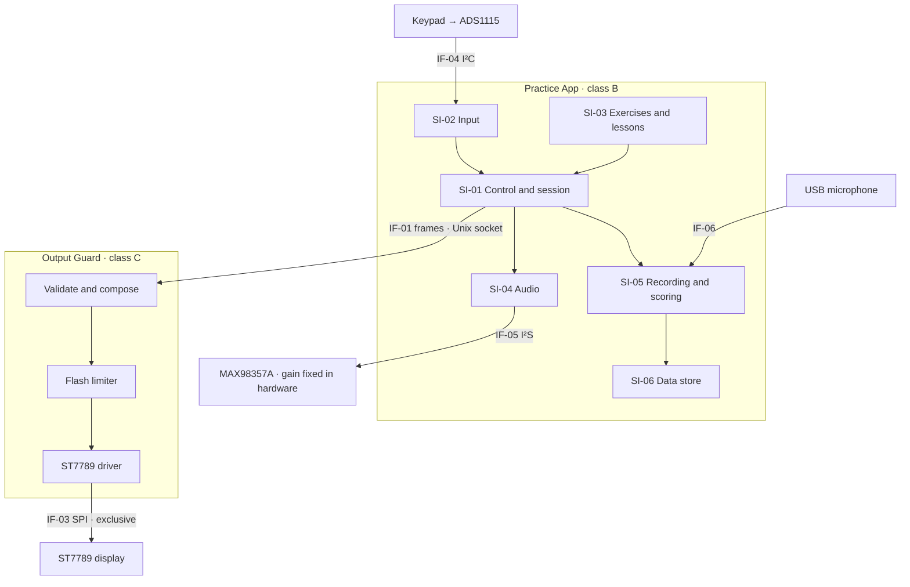

# AL-ADR-0001: Segregate display output into a class C Output Guard process

> **TEACHING MATERIAL · NOT A MEDICAL DEVICE · FOR EDUCATIONAL PURPOSES ONLY**
>
> This is a fictional worked example of an architecture decision record.
> It is not a real record, it does not describe a real product, and it is not evidence of conformity with any regulation or standard.

## Read this first

### Purpose of this document

This document teaches how to write an architecture decision record (ADR) for software in a medical device.
It shows the sections that Regulation (EU) 2017/745 (MDR), IEC 62304, and ISO 14971 add to an ordinary software ADR.
Use it for training sessions, workshops, and self-study.

### About Alfa and the fictional Alfa-L

- Alfa is an open-source hobby project: a small offline radio that helps children learn letters.
- Alfa is not a medical device. It has no medical intended purpose and makes no medical claims.
  It is not intended for the diagnosis, prevention, monitoring, treatment, or alleviation of any disease, injury, or disability.
- Alfa holds no licence, certificate, CE marking, registration, notified body assessment, or regulatory approval of any kind.
- Alfa-L does not exist. It was invented for this exercise.
  Nobody manufactures, sells, supplies, places on the market, or puts into service any device described here.
- Alfa's original code and technical documentation, including this example, are published under the MIT License.
  That license provides them "as is", without warranty of any kind. See [LICENSE](https://github.com/hvitis/Alfa/blob/main/LICENSE).
- The real Alfa architecture is in [ADR 0001](adr.md).

### What is fictional

- Everything about Alfa-L is invented: its intended purpose, classification, hazards, requirements, test results, document IDs, roles, dates, and records.
- No review, test, or approval took place. The approval and revision tables show the format only. Nobody signed anything.
- Organisation types such as "notified body" are generic. No real organisation reviewed or endorsed this document.

### Limits of use

- This document is not legal, regulatory, clinical, or medical advice.
- Its summaries of regulations and standards come from public sources. They may be incomplete, out of date, or wrong. Check the official texts.
- Do not submit this document, or any part of it, as real technical documentation.
  Do not cite it as evidence that any device, including Alfa, is safe, effective, or conforms to any requirement.
- A real ADR needs its own intended purpose, risk analysis, verification evidence, and review by qualified people.
- If you copy or adapt this example, keep this notice and the "TEACHING MATERIAL" marking.

### How to read this example

| Section | What it teaches |
| --- | --- |
| Document control | Every design record has an ID, version, status, owner, and links to related records (ISO 13485 document control). |
| 1. Decision summary | State the decision first, in a few sentences. |
| 2. Context | Describe the intended purpose, the classification, and the problem that forces a decision. |
| 3–4. Drivers and requirements | Trace every driver and requirement to its source. Write each requirement as one testable "shall" statement. |
| 5. Considered options | Compare real alternatives against the drivers, and record why each one lost. |
| 6. Decision outcome | Add the medical device content: software items and safety classes, interfaces, segregation, SOUP, risk controls, and security. |
| 7–10. Consequences to revisit triggers | Record the costs, how the decision is verified, who does what next, and what would reopen the decision. |
| 11–14. Related decisions to revision history | Link the decision log, references, approvals, and changes. |

## Document control

| Field | Value |
| --- | --- |
| Document classification | TEACHING MATERIAL. Not a medical device. For educational purposes only. |
| Document ID | AL-ADR-0001, version 1.0 (fictional) |
| Status | Accepted (fictional) |
| Effective date | 2026-10-12 (fictional) |
| Product | Alfa-L home speech-practice device, software 1.x |
| Owner | Software Architect |
| Document type | Design and development output (ISO 13485 §7.3.4), part of the software architecture (IEC 62304 §5.3) |
| Technical documentation | MDR Annex II §3 (design information) and §6.1(b) (software verification and validation) |
| Supersedes | Alfa ADR 0001, for the Alfa-L product line only |
| Depends on | AL-ADR-0002, AL-ADR-0003 |

## 1. Decision summary

Alfa-L runs as two processes.
The **Output Guard** is the only process that can write to the display, and it checks every frame against the flash limit.
The **Practice App** keeps the existing Alfa code and has no access to the display hardware.
This limits IEC 62304 class C work to one small software item instead of the whole application.

## 2. Context

### 2.1 Intended purpose and users

Alfa-L supports home practice of Polish speech sounds by children aged 3 to 7 with a diagnosed speech sound disorder.
A speech-language therapist selects the exercises and directs the therapy (intended purpose IP-001).
Alfa-L records the child's attempts and computes a practice score for each sound.
The therapist uses the score to decide when to move to the next sound.
Alfa-L does not diagnose.

| User group | Profile | Main tasks |
| --- | --- | --- |
| Child | 3–7 years, cannot read, may hold or mash buttons | Practise sounds with five buttons |
| Caregiver | Lay person | Charge the device, start practice, report problems |
| Therapist | Speech-language therapist | Set the exercise plan, read scores on the device |

### 2.2 Regulatory classification

- **MDR class IIa** under Annex VIII Rule 11: the practice score is information used to take therapeutic decisions.
  A wrong decision delays therapy but cannot cause a serious deterioration of health, so classes IIb and III do not apply.
- Without the score, Alfa-L would be class I under Rule 13. Product decision PD-003 keeps the score.
- Conformity assessment follows Annex IX with a notified body.
- The IEC 62304 software system class is C because of HAZ-02 (section 6.3).

### 2.3 Problem

Consumer Alfa is one Python process of about 2,500 lines.
It reads the buttons, plays audio, renders lessons and animations, and drives the ST7789 display.
The boot splash is a second program that also writes to the display.

The display shows animations at up to 20 frames per second.
A defect anywhere in the process could make the screen flash and contribute to HAZ-02, a photosensitive seizure.
A seizure is a serious injury, so software that can cause one is class C.
The current artwork stays well below the flash limit. The hazard comes from defects, not from the content.

IEC 62304 §4.3 allows a software item a lower class than its system only when the manufacturer documents how the item is segregated.
Nothing segregates items inside one process, so today every line would be class C.
Class C adds detailed design for every unit and interface (§5.4.2–§5.4.4) and additional unit acceptance criteria (§5.5.4).

## 3. Decision drivers

| ID | Driver | Source |
| --- | --- | --- |
| DD-1 | Control HAZ-02 with a measure whose effectiveness can be verified, also under a single fault | ISO 14971 §7.1, §7.2; MDR Annex I GSPR 4 and 17.1 |
| DD-2 | Keep the class C scope as small as possible | IEC 62304 §4.3, §5.3.5 |
| DD-3 | Reuse the existing Alfa code and its tests | Software development plan SDP-001 |
| DD-4 | Stay offline with a short SOUP list and a small attack surface | AL-ADR-0003; GSPR 17.2, 17.4; IEC 81001-5-1 |
| DD-5 | Respond to a child's press within 150 ms | SRS-021; IEC 62366-1 use specification |
| DD-6 | Keep the validated Raspberry Pi 3 hardware and its unit cost | Product requirements PRS-001 |

## 4. Requirements in scope

Each requirement states one testable property, traces to its source, and names its verification.

| ID | Requirement | Traces to | Verification |
| --- | --- | --- | --- |
| SRS-010 | The software shall not enable any network interface. | AL-ADR-0003, SEC-01 | Inspection and test VER-SYS-010 |
| SRS-021 | The device shall give audible or visible feedback within 150 ms of a button press, at the 95th percentile. | UN-004, DD-5 | Test VER-SYS-021 |
| SRS-030 | The display shall show no more than three flashes in any one-second period. A flash is a pair of opposing luminance changes of at least 20 cd/m² where the darker image is below 160 cd/m², or a transition to or from saturated red. Only flashes that cover more than 25 % of the screen count (ITU-R BT.1702). | HAZ-02, RCM-03 | Test VER-SW-030 |
| SRS-031 | When a new frame would exceed the SRS-030 limit, the Output Guard shall keep the last compliant frame on the display. | HAZ-02, RCM-03 | Test VER-SW-031 |
| SRS-032 | Only the Output Guard shall have access to the SPI display device and the display control lines. | HAZ-02, RCM-04 | Inspection and test VER-SW-032 |
| SRS-033 | The Output Guard shall add no more than 10 ms per frame, at the 95th percentile. | SRS-021 | Test VER-SW-033 |

## 5. Considered options

- **A. Single process.** Keep consumer Alfa unchanged and add the flash limiter inside it.
- **B. Output Guard process.** Move the display driver and a flash limiter into a separate process that alone owns the display.
- **C. RP2040 co-processor.** Put a Raspberry Pi Pico between the Pi and the display. Its firmware enforces the limit.
- **D. Tablet app.** Rebuild Alfa-L as an app for an off-the-shelf tablet.

| Driver | A. Single process | B. Output Guard process | C. RP2040 co-processor | D. Tablet app |
| --- | --- | --- | --- | --- |
| DD-1 HAZ-02 control | Weak: the limiter shares memory with all other code | Good: the operating system enforces the boundary | Best: separate hardware | Weak: the operating system can draw over the app |
| DD-2 Class C scope | Whole app, about 2,500 lines | Output Guard, estimated 400 lines | New firmware, estimated 600 lines | Whole app |
| DD-3 Reuse | Complete | High: only the display driver moves | Medium: new firmware and protocol | None |
| DD-4 Offline, short SOUP list | Good | Good | Good, adds the Pico SDK | Poor: network, store updates, large OS |
| DD-5 150 ms response | Good | Good, under 10 ms added | Good | Good |
| DD-6 Hardware and cost | No change | No change | Extra board and a second firmware release process | New platform |

Why the other options lost:

- **A** fails DD-2. Every change anywhere in the app would need class C evidence.
- **C** gives the strongest control but adds a second safety-critical product with its own toolchain and release process. It is the fallback if the notified body rejects process segregation (section 10).
- **D** depends on an operating system the manufacturer does not control and on network updates. With headphones connected, the hardware sound limit of AL-ADR-0002 no longer applies.

## 6. Decision outcome

Chosen option: **B. Output Guard process**.
It is the only option that controls HAZ-02 behind a boundary enforced by the operating system, keeps class C work to one small item, and reuses the existing code.

### 6.1 Architecture

### 6.2 Software items

| ID | Software item | Responsibility | Origin in consumer Alfa | Process | Class |
| --- | --- | --- | --- | --- | --- |
| SI-01 | Control and session | Control loop, button actions, screen state | `app/app.py`, `app/player.py` | Practice App | B |
| SI-02 | Input | ADC reading, calibration, `Debouncer`, `PressGuard` | `app/buttons.py`, `ADS1x15` in `app/hardware.py` | Practice App | B |
| SI-03 | Exercises and lessons | Letter lessons, animations, prepared media | `app/letter_lesson.py`, `app/letter_paths.py`, `app/frames.py` | Practice App | B |
| SI-04 | Audio | Playback and the software volume cap | `app/audio.py` | Practice App | B |
| SI-05 | Recording and scoring | Record attempts and compute a score for each sound | New (AL-ADR-0004) | Practice App | B |
| SI-06 | Data store | Practice log, recordings, deletion after 14 days | New | Practice App | B |
| SI-07 | Output Guard | Frame validation, flash limiter, ST7789 driver, boot image, its own watchdog | `ST7789` in `app/hardware.py` and `app/splash.py`; replaces `app/display_handoff.py`; the limiter is new | Output Guard | C |
| SI-08 | App supervision | Readiness and watchdog for the Practice App | `app/service.py` | Practice App | B |

Items in the Practice App inherit class B.
None is classified A, because nothing segregates items inside one Python process.
HAZ-03 makes the Practice App class B.
HAZ-01 does not raise it, because AL-ADR-0002 limits the sound pressure in hardware.

### 6.3 Software safety classification

| Hazard | Harm | Severity | Software contribution | External risk control | Effect on classes |
| --- | --- | --- | --- | --- | --- |
| HAZ-01 Excessive sound pressure | Noise-induced hearing loss | Serious | The Practice App sends audio samples | RCM-01, hardware gain limit | None: at full digital scale the level stays acceptable |
| HAZ-02 Flashing images | Photosensitive seizure | Serious | Any code that produces frames | None | SI-07 is class C; the other items are segregated from it |
| HAZ-03 Wrong practice score | Delayed or prolonged therapy | Non-serious | SI-05 | RCM-06, therapist review (partial) | Practice App is class B |
| HAZ-04 Device stops responding | Missed practice session | No injury | Any item | None needed | None |

### 6.4 Interfaces

| ID | Interface | Between | Mechanism | Contract |
| --- | --- | --- | --- | --- |
| IF-01 | Frame submission | Practice App → Output Guard | Unix domain socket `/run/alfa/frame.sock`, `SOCK_SEQPACKET` | Sequence number, region (x, y, width, height), RGB565 pixels, CRC-32. The Guard rejects malformed messages. |
| IF-02 | Frame status | Output Guard → Practice App | Same socket | `SHOWN`, `HELD`, or `REJECTED` for each sequence number |
| IF-03 | Display bus | Output Guard → ST7789 | SPI0, GPIO 24, 25, and 27 | Output Guard only |
| IF-04 | Buttons | Keypad → Practice App | ADS1115 on I²C bus 1 | Unchanged |
| IF-05 | Speaker | Practice App → MAX98357A | ALSA, I²S | Unchanged; gain fixed in hardware |
| IF-06 | Microphone | USB microphone → Practice App | ALSA capture | New |

The Practice App already sends changed rectangles (`AnimationPresenter`, `ST7789.show_region`).
The Output Guard composes each rectangle into its own copy of the full frame and analyses that frame before it reaches the panel.

### 6.5 Segregation (IEC 62304 §5.3.5)

- The two processes run as different Linux users, `alfa-app` and `alfa-guard`.
- udev rules give `/dev/spidev0.0` and `/dev/gpiochip0` to the `alfa-guard` group only.
  The Practice App needs neither: its buttons use I²C, and it sends frames through IF-01.
- The Output Guard trusts nothing it receives.
  It checks the size and CRC, composes the frame, and analyses it before writing to the panel.
- systemd limits the Practice App's memory and CPU, so the App cannot starve the Guard.
- If the Guard stops, the ST7789 keeps its last image. A static image is the safe state for HAZ-02.
  systemd restarts the Guard within 2 s.
- Assumption: Linux process isolation and file permissions work as specified (SOUP-01).
  Each release reviews the kernel's published anomalies.

### 6.6 SOUP (IEC 62304 §5.3.3, §5.3.4, §8.1.2)

| ID | SOUP item and version | Used by | Required function or performance | Highest class of a using item |
| --- | --- | --- | --- | --- |
| SOUP-01 | Raspberry Pi OS Lite 12 (Bookworm), Linux 6.6 | All | Process isolation, file permissions, SPI, I²C, and I²S drivers | C |
| SOUP-02 | systemd 252 | All | Restart a failed service within 2 s; enforce resource limits | C |
| SOUP-03 | CPython 3.11 | All | Interpreter | C |
| SOUP-04 | NumPy 1.26 | SI-07 | Analyse a 240 × 320 frame in under 5 ms on the Raspberry Pi 3 | C |
| SOUP-05 | spidev 3.8, gpiozero 2.0 with lgpio | SI-07 | SPI writes and display control lines | C |
| SOUP-06 | Pillow 12 | SI-01, SI-03 | Image composition | B |
| SOUP-07 | smbus2 0.6 | SI-02 | I²C reads from the ADC | B |
| SOUP-08 | alsa-utils 1.2 (`aplay`, `arecord`) | SI-04, SI-05 | 48 kHz PCM playback and capture without underruns at a 100 ms buffer | B |

FFmpeg is not on the device.
Media is prepared at build time with the existing `--prepared-only` mode.
FFmpeg is therefore a validated build tool (ISO 13485 §4.1.6), not SOUP.

### 6.7 Risk control measures

| ID | Hazard | Measure | GSPR 4 priority | Implemented in | Verification |
| --- | --- | --- | --- | --- | --- |
| RCM-01 | HAZ-01 | Amplifier gain fixed at its lowest setting. At full digital scale the level is at most 75 dB(A) at 10 cm. | 1. Safe design | Hardware (AL-ADR-0002) | VER-HW-003 |
| RCM-02 | HAZ-01 | Software volume cap. Kept for comfort and not credited as a risk control. | Not credited | SI-04 | VER-SW-014 |
| RCM-03 | HAZ-02 | The flash limiter holds the last compliant frame | 2. Protective measure | SI-07 | VER-SW-030, VER-SW-031 |
| RCM-04 | HAZ-02 | Only the Output Guard can access the display | 2. Protective measure | SI-07, OS configuration | VER-SW-032 |
| RCM-05 | HAZ-03 | The score stays hidden until a sound has 10 attempts, and the attempt count is always shown | 2. Protective measure | SI-05 | VER-SW-040 |
| RCM-06 | HAZ-03 | The instructions tell the therapist to listen to sample recordings before moving on | 3. Information for safety | Instructions for use §7 | Usability validation UV-002 |

### 6.8 Security and data protection

- **No network.** `dtoverlay=disable-wifi` and `dtoverlay=disable-bt` turn off the radios, and the release image has no SSH server (AL-ADR-0003).
- **Health data.** Recordings of a child's speech in therapy are health data under GDPR Art. 9.
  They stay on the device and are deleted after 14 days.
  The therapist reads scores on the device, in a menu opened with a button code.
- **Updates.** Updates arrive as signed packages on a USB stick. The updater checks the signature before it installs anything.
- **Residual risk.** The Raspberry Pi 3 has no secure boot, so someone with physical access can replace the SD card.
  Security risk assessment SRA-001 accepts this risk: the device is offline and holds at most 14 days of recordings.
- **SBOM.** Every build produces a CycloneDX software bill of materials that lists all SOUP items.

## 7. Consequences

**Positive**

- Class C rigor applies to about 400 lines instead of 2,500. Changes to lessons, audio, or scoring need class B evidence only.
- The boot splash no longer writes to the display. Each safety-relevant output has one owner.
- HAZ-01 is controlled by design, so the software volume cap is only a comfort feature.
- FFmpeg leaves the device, which shortens the SOUP list.

**Negative**

- There are two processes and a frame protocol to design, test, and maintain.
- Each frame needs one more copy and analysis, up to 10 ms.
- The Linux kernel, systemd, and CPython become SOUP in a class C path. Their anomaly lists need review for the life of the device.
- Therapists must have the device in hand to read scores. There is no remote report.

**Regulatory and quality**

- Any change to SI-07 needs a class C impact analysis and regression testing (IEC 62304 §6.2, §7.4).
- The risk management file RMF-001 and the SOUP list must reference RCM-03, RCM-04, and SOUP-01 to SOUP-08.
- If the score feature is removed, reassess the classification. Alfa-L would become class I.

## 8. Confirmation

The decision is confirmed when these records exist and pass.
All records and results in this table are fictional. No review or test took place.

| Record | Evidence | Status |
| --- | --- | --- |
| REV-2026-031 | Architecture review (IEC 62304 §5.3.6) by the Software Architect, Risk Manager, QA, Regulatory Affairs, and Security Lead | Passed 2026-10-09 (fictional); two minor findings closed |
| VER-HW-003 | Sound level measured at 10 cm with a full-scale test tone | Passed 2026-10-06 (fictional) |
| VER-SW-030 | Recorded frame sequences, including all 32 letter lessons, analysed at the Guard output | Planned |
| VER-SW-031 | Fault injection: the Practice App sends full-screen black and white at 20 frames per second. A photodiode on the panel counts at most three flashes per second. | Planned |
| VER-SW-032 | As `alfa-app`, opening the SPI and GPIO devices fails with a permission error | Planned |
| VER-SW-033 | Guard latency over 10,000 frames on a Raspberry Pi 3 | Planned |

## 9. Follow-up actions

| ID | Action | Owner | Due |
| --- | --- | --- | --- |
| ACT-01 | Move the ST7789 driver and the boot image into the Output Guard; remove display access from the Practice App | Software Lead | 2026-11-06 |
| ACT-02 | Add the users, udev rules, and systemd limits to the release image | DevOps Engineer | 2026-11-06 |
| ACT-03 | Update RMF-001 and the SOUP list with this decision's measures and SOUP items | Risk Manager | 2026-10-23 |
| ACT-04 | Add the kernel, systemd, and CPython anomaly review to the release checklist | QA Engineer | 2026-10-30 |
| ACT-05 | Present the segregation argument to the notified body before submission | Regulatory Affairs | 2026-12-04 |

## 10. When to revisit

Write a new ADR that supersedes this one if any of these happens:

- The notified body does not accept process segregation. The fallback is option C.
- The display, its interface, or the frame rate changes.
- VER-SW-033 measures more than 10 ms per frame.
- The score feature is removed and the classification changes.

## 11. Related decisions

| ID | Title | Status | Relation to this decision |
| --- | --- | --- | --- |
| AL-ADR-0002 | Limit the maximum sound pressure in hardware | Accepted | Keeps HAZ-01 from raising the Practice App's class |
| AL-ADR-0003 | Offline device; therapists read results on the device | Accepted | Removes the network from the attack surface |
| AL-ADR-0004 | Score speech with deterministic signal processing, not a trained model | Proposed | A trained model could make SI-05 a high-risk AI system under Regulation (EU) 2024/1689 |

## 12. References

- Regulation (EU) 2017/745 (MDR): Annex I GSPR 4, 17.1, 17.2, and 17.4; Annex II; Annex VIII Rules 11 and 13; Annex IX
- MDCG 2019-11, qualification and classification of software
- MDCG 2019-16, cybersecurity for medical devices
- IEC 62304:2006+A1:2015, medical device software life cycle processes
- EN ISO 14971:2019+A11:2021, application of risk management to medical devices
- EN 62366-1:2015+A1:2020, application of usability engineering to medical devices
- EN ISO 13485:2016+A11:2021, quality management systems
- IEC 81001-5-1:2021, security for health software
- Recommendation ITU-R BT.1702, reducing the risk of photosensitive epilepsy from television images
- Regulation (EU) 2016/679 (GDPR), Art. 9 and Art. 25
- Internal: IP-001, PRS-001, SDP-001, SRS-001, RMF-001, SRA-001, SOUP-001

## 13. Approval

In a real quality system, these people sign in the electronic QMS under a document control procedure.
This example shows the format only. Nobody signed anything.

| Role | Responsibility | Signature | Date |
| --- | --- | --- | --- |
| Software Architect | Author | None: example only | — |
| Risk Manager | Reviewer: risk controls and software safety classes | None: example only | — |
| Regulatory Affairs | Reviewer: MDR classification and technical documentation | None: example only | — |
| Security Lead | Reviewer: security and data protection | None: example only | — |
| Quality Assurance | Approver: document control | None: example only | — |

## 14. Revision history

This history is fictional and shows the format only.

| Version | Date | Change | Author |
| --- | --- | --- | --- |
| 0.1 | 2026-09-22 | First draft with options A–D | Software Architect |
| 0.2 | 2026-10-02 | Risk review: added RCM-04 and the CPU starvation case | Software Architect |
| 0.3 | 2026-10-09 | Closed the two minor findings from REV-2026-031 | Software Architect |
| 1.0 | 2026-10-12 | Approved | Software Architect |

## Glossary

| Term | Meaning |
| --- | --- |
| GSPR | General safety and performance requirement, MDR Annex I |
| Notified body | Organisation designated to assess the conformity of most devices above class I |
| RCM | Risk control measure (ISO 14971) |
| Segregation | Separation that stops one software item from affecting another (IEC 62304 §5.3.5) |
| Software item | Any identifiable part of the software. A unit is an item that is not divided further. |
| Software safety class | A, B, or C, set by the worst harm the software can contribute to after external risk controls (IEC 62304 §4.3) |
| SOUP | Software of unknown provenance: third-party software not developed under this quality system (IEC 62304) |

## End of teaching example

**TEACHING MATERIAL · NOT A MEDICAL DEVICE · FOR EDUCATIONAL PURPOSES ONLY**

Alfa-L and every record in this document are fictional.
Alfa is an open-source hobby project with no medical purpose and no regulatory licence, certificate, or approval.
This document is not advice and is provided "as is", without warranty of any kind.
