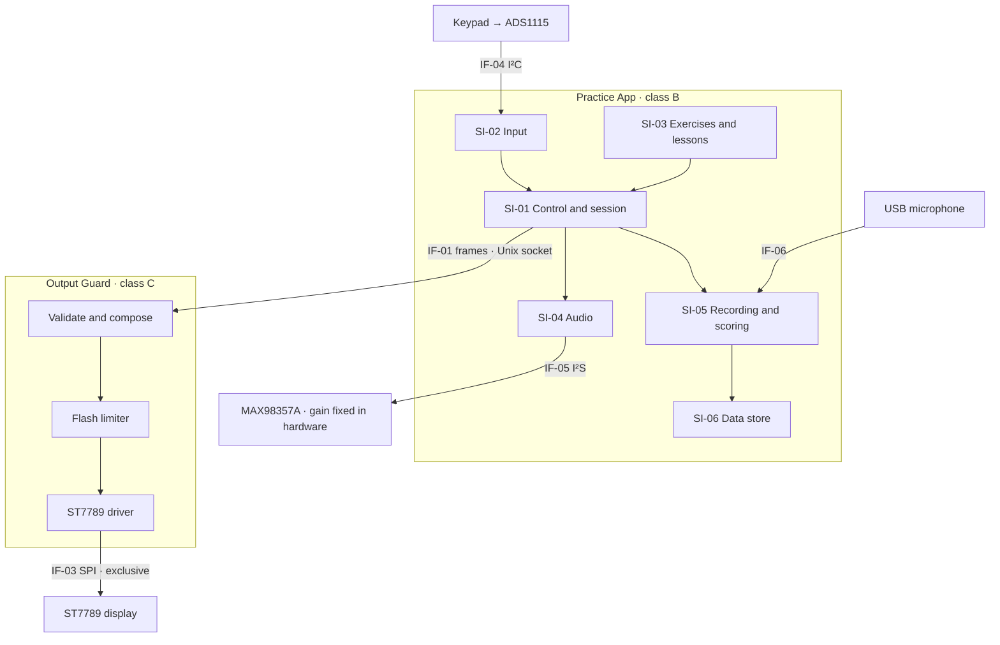

# AL-ADR-0001: Wydzielenie wyjścia na wyświetlacz do procesu Output Guard klasy C

> **TEACHING MATERIAL · NOT A MEDICAL DEVICE · FOR EDUCATIONAL PURPOSES ONLY**
>
> To jest fikcyjny, opracowany przykład rejestru decyzji architektonicznej.
> Nie jest prawdziwym zapisem, nie opisuje prawdziwego wyrobu i nie jest dowodem zgodności z żadnym przepisem ani normą.

## Przeczytaj to najpierw (Read this first)

### Cel tego dokumentu

Ten dokument uczy, jak napisać rejestr decyzji architektonicznej (ADR) dla oprogramowania w wyrobie medycznym.
Pokazuje sekcje, które rozporządzenie (UE) 2017/745 (MDR), IEC 62304 i ISO 14971 dodają do zwykłego ADR oprogramowania.
Służy do szkoleń, warsztatów i samodzielnej nauki.

### O Alfie i fikcyjnym Alfa-L

- Alfa to hobbystyczny projekt open source: małe radio offline, które pomaga dzieciom uczyć się liter.
- Alfa is not a medical device. Alfa nie jest wyrobem medycznym. Nie ma medycznego przeznaczenia i nie zgłasza żadnych twierdzeń medycznych.
  Nie jest przeznaczona do diagnozowania, zapobiegania, monitorowania, leczenia ani łagodzenia jakiejkolwiek choroby, urazu lub niepełnosprawności.
- Alfa nie ma żadnej licencji, certyfikatu, oznakowania CE, rejestracji, oceny jednostki notyfikowanej ani zatwierdzenia regulacyjnego.
- Alfa-L does not exist. Alfa-L nie istnieje. Wymyślono je na potrzeby tego ćwiczenia.
  Nikt nie wytwarza, nie sprzedaje, nie dostarcza, nie wprowadza do obrotu ani nie oddaje do użytku żadnego urządzenia opisanego tutaj.
- Oryginalny kod Alfy i dokumentacja techniczna, w tym ten przykład, są opublikowane na licencji MIT.
  Licencja udostępnia je „tak jak są”, bez jakiejkolwiek gwarancji. Zobacz [LICENSE](https://github.com/hvitis/Alfa/blob/main/LICENSE).
- Prawdziwa architektura Alfy jest w [ADR 0001](adr.md).

### Co jest fikcyjne

- Wszystko o Alfa-L jest wymyślone: przeznaczenie, klasyfikacja, zagrożenia, wymagania, wyniki badań, identyfikatory dokumentów, role, daty i zapisy.
- Nie odbył się żaden przegląd, test ani zatwierdzenie. Tabele zatwierdzenia i rewizji pokazują tylko format. Nobody signed anything.
- Typy organizacji, takie jak „jednostka notyfikowana”, są ogólne. Żadna prawdziwa organizacja nie recenzowała ani nie poparła tego dokumentu.

### Granice użycia

- Ten dokument nie jest poradą prawną, regulacyjną, kliniczną ani medyczną.
- Streszczenia przepisów i norm pochodzą ze źródeł publicznych. Mogą być niepełne, nieaktualne albo błędne. Sprawdź teksty urzędowe.
- Nie składaj tego dokumentu ani żadnej jego części jako prawdziwej dokumentacji technicznej.
  Nie powołuj się na niego jako na dowód, że jakiekolwiek urządzenie, w tym Alfa, jest bezpieczne, skuteczne albo zgodne z jakimkolwiek wymaganiem.
- Prawdziwy ADR potrzebuje własnego przeznaczenia, analizy ryzyka, dowodów weryfikacji i przeglądu przez osoby kompetentne.
- Jeśli kopiujesz albo adaptujesz ten przykład, zachowaj tę informację i oznaczenie „TEACHING MATERIAL”.

### Jak czytać ten przykład

| Sekcja | Czego uczy |
| --- | --- |
| Kontrola dokumentu | Każdy zapis projektowy ma identyfikator, wersję, status, właściciela i powiązania z innymi zapisami (kontrola dokumentów ISO 13485). |
| 1. Podsumowanie decyzji | Najpierw zapisz decyzję, w kilku zdaniach. |
| 2. Kontekst | Opisz przeznaczenie, klasyfikację i problem, który wymusza decyzję. |
| 3–4. Czynniki i wymagania | Każdy czynnik i wymaganie powiąż ze źródłem. Każde wymaganie zapisz jako jedno sprawdzalne zdanie „shall” / „musi”. |
| 5. Rozważane opcje | Porównaj realne alternatywy z czynnikami i zapisz, dlaczego każda przegrała. |
| 6. Wynik decyzji | Dodaj treść wyrobu medycznego: elementy oprogramowania i klasy bezpieczeństwa, interfejsy, segregację, SOUP, środki kontroli ryzyka i bezpieczeństwo. |
| 7–10. Od konsekwencji do powodów ponownego otwarcia | Zapisz koszty, sposób weryfikacji decyzji, kto co robi dalej i co otworzyłoby decyzję na nowo. |
| 11–14. Od powiązanych decyzji do historii rewizji | Połącz dziennik decyzji, odniesienia, zatwierdzenia i zmiany. |

## Kontrola dokumentu

| Pole | Wartość |
| --- | --- |
| Klasyfikacja dokumentu | TEACHING MATERIAL. To nie jest wyrób medyczny. Wyłącznie do celów edukacyjnych. |
| Identyfikator dokumentu | AL-ADR-0001, wersja 1.0 (fikcja) |
| Status | Zaakceptowany (fikcja) |
| Data obowiązywania | 2026-10-12 (fikcja) |
| Wyrób | Domowe urządzenie Alfa-L do ćwiczenia mowy, oprogramowanie 1.x |
| Właściciel | Architekt oprogramowania |
| Typ dokumentu | Wynik projektowania i rozwoju (ISO 13485 §7.3.4), część architektury oprogramowania (IEC 62304 §5.3) |
| Dokumentacja techniczna | MDR załącznik II §3 (informacje o projekcie) i §6.1(b) (weryfikacja i walidacja oprogramowania) |
| Zastępuje | Alfa ADR 0001, wyłącznie dla linii wyrobu Alfa-L |
| Zależy od | AL-ADR-0002, AL-ADR-0003 |

## 1. Podsumowanie decyzji

Alfa-L działa jako dwa procesy.
**Output Guard** jest jedynym procesem, który może pisać na wyświetlacz, i sprawdza każdą klatkę względem limitu błysków.
**Practice App** zachowuje istniejący kod Alfy i nie ma dostępu do sprzętu wyświetlacza.
Ogranicza to pracę klasy C według IEC 62304 do jednego małego elementu oprogramowania zamiast całej aplikacji.

## 2. Kontekst

### 2.1 Przeznaczenie i użytkownicy

Alfa-L wspiera domowe ćwiczenie polskich dźwięków mowy przez dzieci w wieku od 3 do 7 lat ze zdiagnozowanym zaburzeniem dźwięków mowy.
Logopeda wybiera ćwiczenia i kieruje terapią (przeznaczenie IP-001).
Alfa-L nagrywa próby dziecka i oblicza wynik ćwiczenia dla każdego dźwięku.
Terapeuta używa wyniku, żeby zdecydować, kiedy przejść do następnego dźwięku.
Alfa-L nie diagnozuje.

| Grupa użytkowników | Profil | Główne zadania |
| --- | --- | --- |
| Dziecko | 3–7 lat, nie czyta, może trzymać albo miażdżyć przyciski | Ćwiczy dźwięki pięcioma przyciskami |
| Opiekun | Osoba bez wykształcenia medycznego | Ładuje urządzenie, uruchamia ćwiczenie, zgłasza problemy |
| Terapeuta | Logopeda | Ustawia plan ćwiczeń, czyta wyniki na urządzeniu |

### 2.2 Klasyfikacja regulacyjna

- **MDR klasa IIa** według załącznika VIII, reguła 11: wynik ćwiczenia jest informacją używaną do decyzji terapeutycznych.
  Błędna decyzja opóźnia terapię, ale nie może spowodować poważnego pogorszenia stanu zdrowia, więc klasy IIb i III nie mają zastosowania.
- Bez wyniku Alfa-L byłoby klasą I według reguły 13. Decyzja produktowa PD-003 zostawia wynik.
- Ocena zgodności przebiega według załącznika IX z udziałem jednostki notyfikowanej.
- Klasa systemu oprogramowania według IEC 62304 to C z powodu HAZ-02 (sekcja 6.3).

### 2.3 Problem

Konsumencka Alfa to jeden proces Pythona, około 2500 linii.
Czyta przyciski, odtwarza dźwięk, renderuje lekcje i animacje oraz steruje wyświetlaczem ST7789.
Ekran startowy to drugi program, który też pisze na wyświetlacz.

Wyświetlacz pokazuje animacje do 20 klatek na sekundę.
Wada w dowolnym miejscu procesu mogłaby sprawić, że ekran błyska, i przyczynić się do HAZ-02, napadu związanego z nadwrażliwością na światło.
Napad jest poważnym urazem, więc oprogramowanie, które może go spowodować, jest klasy C.
Obecna grafika zostaje wyraźnie poniżej limitu błysków. Zagrożenie pochodzi z wad, nie z treści.

IEC 62304 §4.3 pozwala nadać elementowi oprogramowania klasę niższą niż system tylko wtedy, gdy wytwórca udokumentuje, jak element jest segregowany.
Nic nie segreguje elementów wewnątrz jednego procesu, więc dziś każda linia byłaby klasy C.
Klasa C dodaje szczegółowy projekt każdej jednostki i interfejsu (§5.4.2–§5.4.4) oraz dodatkowe kryteria odbioru jednostek (§5.5.4).

## 3. Czynniki decyzji

| ID | Czynnik | Źródło |
| --- | --- | --- |
| DD-1 | Kontrolować HAZ-02 środkiem, którego skuteczność da się zweryfikować, także przy pojedynczym uszkodzeniu | ISO 14971 §7.1, §7.2; MDR załącznik I, GSPR 4 i 17.1 |
| DD-2 | Utrzymać zakres klasy C tak mały, jak to możliwe | IEC 62304 §4.3, §5.3.5 |
| DD-3 | Ponownie użyć istniejącego kodu Alfy i jego testów | Plan rozwoju oprogramowania SDP-001 |
| DD-4 | Zostać offline, z krótką listą SOUP i małą powierzchnią ataku | AL-ADR-0003; GSPR 17.2, 17.4; IEC 81001-5-1 |
| DD-5 | Odpowiedzieć na naciśnięcie dziecka w ciągu 150 ms | SRS-021; specyfikacja użycia IEC 62366-1 |
| DD-6 | Zostać przy zwalidowanym sprzęcie Raspberry Pi 3 i jego koszcie jednostkowym | Wymagania wyrobu PRS-001 |

## 4. Wymagania w zakresie

Każde wymaganie opisuje jedną sprawdzalną właściwość, wskazuje źródło i nazywa weryfikację.

| ID | Wymaganie | Ślad | Weryfikacja |
| --- | --- | --- | --- |
| SRS-010 | Oprogramowanie nie może włączyć żadnego interfejsu sieciowego. | AL-ADR-0003, SEC-01 | Przegląd i test VER-SYS-010 |
| SRS-021 | Urządzenie musi dać słyszalną albo widoczną informację zwrotną w ciągu 150 ms od naciśnięcia przycisku, na 95. percentylu. | UN-004, DD-5 | Test VER-SYS-021 |
| SRS-030 | Wyświetlacz nie może pokazać więcej niż trzech błysków w dowolnej jednosekundowej chwili. Błysk to para przeciwnych zmian luminancji o co najmniej 20 cd/m², gdy ciemniejszy obraz jest poniżej 160 cd/m², albo przejście do nasyconej czerwieni lub z niej. Liczą się tylko błyski obejmujące więcej niż 25% ekranu (ITU-R BT.1702). | HAZ-02, RCM-03 | Test VER-SW-030 |
| SRS-031 | Gdy nowa klatka przekroczyłaby limit SRS-030, Output Guard musi zostawić na wyświetlaczu ostatnią zgodną klatkę. | HAZ-02, RCM-03 | Test VER-SW-031 |
| SRS-032 | Tylko Output Guard może mieć dostęp do urządzenia SPI wyświetlacza i linii sterujących wyświetlaczem. | HAZ-02, RCM-04 | Przegląd i test VER-SW-032 |
| SRS-033 | Output Guard nie może dodać więcej niż 10 ms na klatkę, na 95. percentylu. | SRS-021 | Test VER-SW-033 |

## 5. Rozważane opcje

- **A. Jeden proces.** Zostawić konsumencką Alfę bez zmian i dodać ogranicznik błysków w jej wnętrzu.
- **B. Proces Output Guard.** Przenieść sterownik wyświetlacza i ogranicznik błysków do osobnego procesu, który sam jest właścicielem wyświetlacza.
- **C. Koprocesor RP2040.** Wstawić Raspberry Pi Pico między Pi a wyświetlacz. Jego firmware wymusza limit.
- **D. Aplikacja na tablet.** Zbudować Alfa-L jako aplikację na gotowy tablet.

| Czynnik | A. Jeden proces | B. Proces Output Guard | C. Koprocesor RP2040 | D. Aplikacja na tablet |
| --- | --- | --- | --- | --- |
| DD-1 kontrola HAZ-02 | Słaba: ogranicznik dzieli pamięć z resztą kodu | Dobra: system operacyjny wymusza granicę | Najlepsza: osobny sprzęt | Słaba: system operacyjny może rysować nad aplikacją |
| DD-2 zakres klasy C | Cała aplikacja, około 2500 linii | Output Guard, szacunek 400 linii | Nowe firmware, szacunek 600 linii | Cała aplikacja |
| DD-3 ponowne użycie | Pełne | Wysokie: rusza się tylko sterownik wyświetlacza | Średnie: nowe firmware i protokół | Żadne |
| DD-4 offline, krótka lista SOUP | Dobre | Dobre | Dobre, dodaje Pico SDK | Słabe: sieć, aktualizacje ze sklepu, duży system |
| DD-5 odpowiedź 150 ms | Dobra | Dobra, poniżej 10 ms dodane | Dobra | Dobra |
| DD-6 sprzęt i koszt | Bez zmian | Bez zmian | Dodatkowa płytka i drugi proces wydania firmware | Nowa platforma |

Dlaczego pozostałe opcje przegrały:

- **A** nie spełnia DD-2. Każda zmiana gdziekolwiek w aplikacji wymagałaby dowodów klasy C.
- **C** daje najmocniejszą kontrolę, ale dodaje drugi wyrób krytyczny dla bezpieczeństwa, z własnym łańcuchem narzędzi i procesem wydania. To wariant zapasowy, jeśli jednostka notyfikowana odrzuci segregację procesów (sekcja 10).
- **D** zależy od systemu operacyjnego, którego wytwórca nie kontroluje, i od aktualizacji sieciowych. Po podłączeniu słuchawek sprzętowy limit dźwięku z AL-ADR-0002 przestaje obowiązywać.

## 6. Wynik decyzji

Wybrana opcja: **B. Proces Output Guard**.
To jedyna opcja, która kontroluje HAZ-02 za granicą wymuszoną przez system operacyjny, ogranicza pracę klasy C do jednego małego elementu i ponownie używa istniejącego kodu.

### 6.1 Architektura

### 6.2 Elementy oprogramowania

| ID | Element oprogramowania | Odpowiedzialność | Pochodzenie w konsumenckiej Alfie | Proces | Klasa |
| --- | --- | --- | --- | --- | --- |
| SI-01 | Sterowanie i sesja | Pętla sterowania, akcje przycisków, stan ekranu | `app/app.py`, `app/player.py` | Practice App | B |
| SI-02 | Wejście | Odczyt ADC, kalibracja, `Debouncer`, `PressGuard` | `app/buttons.py`, `ADS1x15` w `app/hardware.py` | Practice App | B |
| SI-03 | Ćwiczenia i lekcje | Lekcje liter, animacje, przygotowane media | `app/letter_lesson.py`, `app/letter_paths.py`, `app/frames.py` | Practice App | B |
| SI-04 | Dźwięk | Odtwarzanie i programowy limit głośności | `app/audio.py` | Practice App | B |
| SI-05 | Nagranie i wynik | Nagrywa próby i liczy wynik dla każdego dźwięku | Nowe (AL-ADR-0004) | Practice App | B |
| SI-06 | Magazyn danych | Dziennik ćwiczeń, nagrania, usunięcie po 14 dniach | Nowe | Practice App | B |
| SI-07 | Output Guard | Walidacja klatki, ogranicznik błysków, sterownik ST7789, obraz startowy, własny watchdog | `ST7789` w `app/hardware.py` i `app/splash.py`; zastępuje `app/display_handoff.py`; ogranicznik jest nowy | Output Guard | C |
| SI-08 | Nadzór aplikacji | Gotowość i watchdog Practice App | `app/service.py` | Practice App | B |

Elementy w Practice App dziedziczą klasę B.
Żaden nie jest klasy A, bo nic nie segreguje elementów wewnątrz jednego procesu Pythona.
HAZ-03 czyni Practice App klasą B.
HAZ-01 jej nie podnosi, bo AL-ADR-0002 ogranicza ciśnienie akustyczne w sprzęcie.

### 6.3 Klasyfikacja bezpieczeństwa oprogramowania

| Zagrożenie | Szkoda | Ciężkość | Udział oprogramowania | Zewnętrzna kontrola ryzyka | Skutek dla klas |
| --- | --- | --- | --- | --- | --- |
| HAZ-01 Nadmierne ciśnienie akustyczne | Ubytek słuchu wywołany hałasem | Poważna | Practice App wysyła próbki dźwięku | RCM-01, sprzętowy limit wzmocnienia | Brak: przy pełnej skali cyfrowej poziom zostaje akceptowalny |
| HAZ-02 Błyskające obrazy | Napad przy nadwrażliwości na światło | Poważna | Każdy kod, który tworzy klatki | Brak | SI-07 jest klasy C; pozostałe elementy są od niego odseparowane |
| HAZ-03 Błędny wynik ćwiczenia | Opóźniona albo przedłużona terapia | Niepoważna | SI-05 | RCM-06, przegląd terapeuty (częściowy) | Practice App jest klasy B |
| HAZ-04 Urządzenie przestaje odpowiadać | Pominięta sesja ćwiczeń | Brak urazu | Dowolny element | Niepotrzebna | Brak |

### 6.4 Interfejsy

| ID | Interfejs | Między | Mechanizm | Kontrakt |
| --- | --- | --- | --- | --- |
| IF-01 | Przekazanie klatki | Practice App → Output Guard | Gniazdo domeny uniksowej `/run/alfa/frame.sock`, `SOCK_SEQPACKET` | Numer sekwencji, region (x, y, szerokość, wysokość), piksele RGB565, CRC-32. Guard odrzuca zniekształcone komunikaty. |
| IF-02 | Status klatki | Output Guard → Practice App | To samo gniazdo | `SHOWN`, `HELD` albo `REJECTED` dla każdego numeru sekwencji |
| IF-03 | Magistrala wyświetlacza | Output Guard → ST7789 | SPI0, GPIO 24, 25 i 27 | Tylko Output Guard |
| IF-04 | Przyciski | Klawiatura → Practice App | ADS1115 na magistrali I²C 1 | Bez zmian |
| IF-05 | Głośnik | Practice App → MAX98357A | ALSA, I²S | Bez zmian; wzmocnienie ustalone w sprzęcie |
| IF-06 | Mikrofon | Mikrofon USB → Practice App | Przechwytywanie ALSA | Nowe |

Practice App już wysyła zmienione prostokąty (`AnimationPresenter`, `ST7789.show_region`).
Output Guard składa każdy prostokąt do własnej kopii pełnej klatki i analizuje tę klatkę, zanim dotrze do panelu.

### 6.5 Segregacja (IEC 62304 §5.3.5)

- Dwa procesy działają jako różni użytkownicy Linuksa, `alfa-app` i `alfa-guard`.
- Reguły udev dają `/dev/spidev0.0` i `/dev/gpiochip0` tylko grupie `alfa-guard`.
  Practice App nie potrzebuje żadnego z nich: przyciski używają I²C, a klatki wysyła przez IF-01.
- Output Guard nie ufa niczemu, co otrzymuje.
  Sprawdza rozmiar i CRC, składa klatkę i analizuje ją przed zapisem na panel.
- systemd ogranicza pamięć i CPU Practice App, więc aplikacja nie może zagłodzić Guarda.
- Jeśli Guard stanie, ST7789 zostawia ostatni obraz. Statyczny obraz jest stanem bezpiecznym dla HAZ-02.
  systemd uruchamia Guarda ponownie w ciągu 2 s.
- Założenie: izolacja procesów Linuksa i uprawnienia plików działają zgodnie ze specyfikacją (SOUP-01).
  Każde wydanie przegląda opublikowane anomalie jądra.

### 6.6 SOUP (IEC 62304 §5.3.3, §5.3.4, §8.1.2)

| ID | Element SOUP i wersja | Używany przez | Wymagana funkcja albo wydajność | Najwyższa klasa elementu używającego |
| --- | --- | --- | --- | --- |
| SOUP-01 | Raspberry Pi OS Lite 12 (Bookworm), Linux 6.6 | Wszystkie | Izolacja procesów, uprawnienia plików, sterowniki SPI, I²C i I²S | C |
| SOUP-02 | systemd 252 | Wszystkie | Restart usługi, która padła, w ciągu 2 s; egzekwowanie limitów zasobów | C |
| SOUP-03 | CPython 3.11 | Wszystkie | Interpreter | C |
| SOUP-04 | NumPy 1.26 | SI-07 | Analiza klatki 240 × 320 w mniej niż 5 ms na Raspberry Pi 3 | C |
| SOUP-05 | spidev 3.8, gpiozero 2.0 z lgpio | SI-07 | Zapisy SPI i linie sterujące wyświetlaczem | C |
| SOUP-06 | Pillow 12 | SI-01, SI-03 | Składanie obrazu | B |
| SOUP-07 | smbus2 0.6 | SI-02 | Odczyty I²C z ADC | B |
| SOUP-08 | alsa-utils 1.2 (`aplay`, `arecord`) | SI-04, SI-05 | Odtwarzanie i przechwytywanie PCM 48 kHz bez niedoborów przy buforze 100 ms | B |

FFmpeg nie ma na urządzeniu.
Media są przygotowywane w czasie budowy istniejącym trybem `--prepared-only`.
FFmpeg jest więc zwalidowanym narzędziem budowy (ISO 13485 §4.1.6), a nie SOUP.

### 6.7 Środki kontroli ryzyka

| ID | Zagrożenie | Środek | Priorytet GSPR 4 | Zaimplementowane w | Weryfikacja |
| --- | --- | --- | --- | --- | --- |
| RCM-01 | HAZ-01 | Wzmocnienie wzmacniacza ustalone na najniższym ustawieniu. Przy pełnej skali cyfrowej poziom wynosi najwyżej 75 dB(A) w odległości 10 cm. | 1. Bezpieczny projekt | Sprzęt (AL-ADR-0002) | VER-HW-003 |
| RCM-02 | HAZ-01 | Programowy limit głośności. Zostawiony dla komfortu i niezaliczony jako kontrola ryzyka. | Niezaliczony | SI-04 | VER-SW-014 |
| RCM-03 | HAZ-02 | Ogranicznik błysków zatrzymuje ostatnią zgodną klatkę | 2. Środek ochronny | SI-07 | VER-SW-030, VER-SW-031 |
| RCM-04 | HAZ-02 | Tylko Output Guard może sięgać do wyświetlacza | 2. Środek ochronny | SI-07, konfiguracja systemu | VER-SW-032 |
| RCM-05 | HAZ-03 | Wynik zostaje ukryty, aż dźwięk ma 10 prób, a liczba prób jest zawsze widoczna | 2. Środek ochronny | SI-05 | VER-SW-040 |
| RCM-06 | HAZ-03 | Instrukcja każe terapeucie odsłuchać próbki nagrań przed przejściem dalej | 3. Informacja dla bezpieczeństwa | Instrukcja użytkowania §7 | Walidacja użyteczności UV-002 |

### 6.8 Bezpieczeństwo i ochrona danych

- **Brak sieci.** `dtoverlay=disable-wifi` i `dtoverlay=disable-bt` wyłączają radia, a obraz wydania nie ma serwera SSH (AL-ADR-0003).
- **Dane o zdrowiu.** Nagrania mowy dziecka w terapii są danymi o zdrowiu według RODO, art. 9.
  Zostają na urządzeniu i są usuwane po 14 dniach.
  Terapeuta czyta wyniki na urządzeniu, w menu otwieranym kodem przycisków.
- **Aktualizacje.** Aktualizacje przychodzą jako podpisane paczki na pendrivie. Aktualizator sprawdza podpis, zanim cokolwiek zainstaluje.
- **Ryzyko resztkowe.** Raspberry Pi 3 nie ma bezpiecznego rozruchu, więc ktoś z fizycznym dostępem może wymienić kartę SD.
  Ocena ryzyka bezpieczeństwa SRA-001 przyjmuje to ryzyko: urządzenie jest offline i trzyma najwyżej 14 dni nagrań.
- **SBOM.** Każda budowa tworzy zestawienie materiałów oprogramowania CycloneDX, które wymienia wszystkie elementy SOUP.

## 7. Konsekwencje

**Pozytywne**

- Rygor klasy C dotyczy około 400 linii zamiast 2500. Zmiany lekcji, dźwięku albo punktacji wymagają tylko dowodów klasy B.
- Ekran startowy już nie pisze na wyświetlacz. Każde wyjście istotne dla bezpieczeństwa ma jednego właściciela.
- HAZ-01 jest kontrolowane przez projekt, więc programowy limit głośności jest tylko funkcją komfortu.
- FFmpeg opuszcza urządzenie, co skraca listę SOUP.

**Negatywne**

- Są dwa procesy i protokół klatek do zaprojektowania, przetestowania i utrzymania.
- Każda klatka potrzebuje jeszcze jednej kopii i analizy, do 10 ms.
- Jądro Linuksa, systemd i CPython stają się SOUP na ścieżce klasy C. Ich listy anomalii trzeba przeglądać przez całe życie urządzenia.
- Terapeuci muszą mieć urządzenie w ręku, żeby czytać wyniki. Nie ma raportu zdalnego.

**Regulacje i jakość**

- Każda zmiana SI-07 wymaga analizy wpływu klasy C i testów regresji (IEC 62304 §6.2, §7.4).
- Plik zarządzania ryzykiem RMF-001 i lista SOUP muszą wskazywać RCM-03, RCM-04 oraz SOUP-01 do SOUP-08.
- Jeśli funkcja wyniku zostanie usunięta, oceń klasyfikację ponownie. Alfa-L stałoby się klasą I.

## 8. Potwierdzenie

Decyzja jest potwierdzona, gdy te zapisy istnieją i przechodzą.
Wszystkie zapisy i wyniki w tej tabeli są fikcyjne. Nie odbył się żaden przegląd ani test.

| Zapis | Dowód | Status |
| --- | --- | --- |
| REV-2026-031 | Przegląd architektury (IEC 62304 §5.3.6) przez architekta oprogramowania, menedżera ryzyka, QA, sprawy regulacyjne i lead bezpieczeństwa | Zaliczony 2026-10-09 (fikcja); dwa drobne ustalenia zamknięte |
| VER-HW-003 | Poziom dźwięku zmierzony w odległości 10 cm pełnoskalowym tonem testowym | Zaliczony 2026-10-06 (fikcja) |
| VER-SW-030 | Nagrane sekwencje klatek, w tym wszystkie 32 lekcje liter, przeanalizowane na wyjściu Guarda | Planowane |
| VER-SW-031 | Wstrzyknięcie usterki: Practice App wysyła pełnoekranową czerń i biel z częstotliwością 20 klatek na sekundę. Fotodioda na panelu liczy najwyżej trzy błyski na sekundę. | Planowane |
| VER-SW-032 | Jako `alfa-app` otwarcie urządzeń SPI i GPIO kończy się błędem uprawnień | Planowane |
| VER-SW-033 | Opóźnienie Guarda na 10 000 klatek na Raspberry Pi 3 | Planowane |

## 9. Działania następne

| ID | Działanie | Właściciel | Termin |
| --- | --- | --- | --- |
| ACT-01 | Przenieść sterownik ST7789 i obraz startowy do Output Guard; usunąć dostęp do wyświetlacza z Practice App | Lead oprogramowania | 2026-11-06 |
| ACT-02 | Dodać użytkowników, reguły udev i limity systemd do obrazu wydania | Inżynier DevOps | 2026-11-06 |
| ACT-03 | Zaktualizować RMF-001 i listę SOUP o środki i elementy SOUP z tej decyzji | Menedżer ryzyka | 2026-10-23 |
| ACT-04 | Dodać przegląd anomalii jądra, systemd i CPythona do listy kontrolnej wydania | Inżynier QA | 2026-10-30 |
| ACT-05 | Przedstawić argument segregacji jednostce notyfikowanej przed złożeniem | Sprawy regulacyjne | 2026-12-04 |

## 10. Kiedy wrócić do decyzji

Napisz nowy ADR, który zastępuje ten, jeśli zdarzy się którekolwiek z poniższych:

- Jednostka notyfikowana nie przyjmuje segregacji procesów. Wariantem zapasowym jest opcja C.
- Zmienia się wyświetlacz, jego interfejs albo liczba klatek.
- VER-SW-033 mierzy więcej niż 10 ms na klatkę.
- Funkcja wyniku zostaje usunięta i zmienia się klasyfikacja.

## 11. Powiązane decyzje

| ID | Tytuł | Status | Związek z tą decyzją |
| --- | --- | --- | --- |
| AL-ADR-0002 | Ograniczyć maksymalne ciśnienie akustyczne w sprzęcie | Zaakceptowany | Nie pozwala HAZ-01 podnieść klasy Practice App |
| AL-ADR-0003 | Urządzenie offline; terapeuci czytają wyniki na urządzeniu | Zaakceptowany | Usuwa sieć z powierzchni ataku |
| AL-ADR-0004 | Oceniać mowę deterministycznym przetwarzaniem sygnału, nie modelem wytrenowanym | Proponowany | Model wytrenowany mógłby uczynić SI-05 systemem AI wysokiego ryzyka według rozporządzenia (UE) 2024/1689 |

## 12. Odniesienia

- Rozporządzenie (UE) 2017/745 (MDR): załącznik I, GSPR 4, 17.1, 17.2 i 17.4; załącznik II; załącznik VIII, reguły 11 i 13; załącznik IX
- MDCG 2019-11, kwalifikacja i klasyfikacja oprogramowania
- MDCG 2019-16, cyberbezpieczeństwo wyrobów medycznych
- IEC 62304:2006+A1:2015, procesy cyklu życia oprogramowania wyrobu medycznego
- EN ISO 14971:2019+A11:2021, zastosowanie zarządzania ryzykiem do wyrobów medycznych
- EN 62366-1:2015+A1:2020, zastosowanie inżynierii użyteczności do wyrobów medycznych
- EN ISO 13485:2016+A11:2021, systemy zarządzania jakością
- IEC 81001-5-1:2021, bezpieczeństwo oprogramowania zdrowotnego
- Zalecenie ITU-R BT.1702, ograniczanie ryzyka padaczki światłoczułej od obrazów telewizyjnych
- Rozporządzenie (UE) 2016/679 (RODO), art. 9 i art. 25
- Wewnętrzne: IP-001, PRS-001, SDP-001, SRS-001, RMF-001, SRA-001, SOUP-001

## 13. Zatwierdzenie

W prawdziwym systemie jakości te osoby podpisują się w elektronicznym SZJ według procedury kontroli dokumentów.
Ten przykład pokazuje tylko format. Nobody signed anything.

| Rola | Odpowiedzialność | Podpis | Data |
| --- | --- | --- | --- |
| Architekt oprogramowania | Autor | Brak: tylko przykład | — |
| Menedżer ryzyka | Recenzent: kontrole ryzyka i klasy bezpieczeństwa oprogramowania | Brak: tylko przykład | — |
| Sprawy regulacyjne | Recenzent: klasyfikacja MDR i dokumentacja techniczna | Brak: tylko przykład | — |
| Lead bezpieczeństwa | Recenzent: bezpieczeństwo i ochrona danych | Brak: tylko przykład | — |
| Zapewnienie jakości | Zatwierdzający: kontrola dokumentów | Brak: tylko przykład | — |

## 14. Historia rewizji

Ta historia jest fikcyjna i pokazuje tylko format.

| Wersja | Data | Zmiana | Autor |
| --- | --- | --- | --- |
| 0.1 | 2026-09-22 | Pierwszy szkic z opcjami A–D | Architekt oprogramowania |
| 0.2 | 2026-10-02 | Przegląd ryzyka: dodano RCM-04 i przypadek zagłodzenia CPU | Architekt oprogramowania |
| 0.3 | 2026-10-09 | Zamknięto dwa drobne ustalenia z REV-2026-031 | Architekt oprogramowania |
| 1.0 | 2026-10-12 | Zatwierdzono | Architekt oprogramowania |

## Słownik

| Termin | Znaczenie |
| --- | --- |
| GSPR | Ogólne wymaganie dotyczące bezpieczeństwa i działania, MDR załącznik I |
| Jednostka notyfikowana | Organizacja wyznaczona do oceny zgodności większości wyrobów powyżej klasy I |
| RCM | Środek kontroli ryzyka (ISO 14971) |
| Segregacja | Rozdzielenie, które powstrzymuje jeden element oprogramowania przed wpływem na inny (IEC 62304 §5.3.5) |
| Element oprogramowania | Każda identyfikowalna część oprogramowania. Jednostka to element, którego się dalej nie dzieli. |
| Klasa bezpieczeństwa oprogramowania | A, B albo C, ustalona według najgorszej szkody, do której oprogramowanie może się przyczynić po zewnętrznych kontrolach ryzyka (IEC 62304 §4.3) |
| SOUP | Oprogramowanie nieznanego pochodzenia: oprogramowanie stron trzecich nieopracowane w tym systemie jakości (IEC 62304) |

## Koniec przykładu szkoleniowego

**TEACHING MATERIAL · NOT A MEDICAL DEVICE · FOR EDUCATIONAL PURPOSES ONLY**

Alfa-L i każdy zapis w tym dokumencie są fikcyjne.
Alfa to hobbystyczny projekt open source bez przeznaczenia medycznego i bez licencji regulacyjnej, certyfikatu ani zatwierdzenia.
Ten dokument nie jest poradą i jest udostępniony „tak jak jest”, bez jakiejkolwiek gwarancji.
